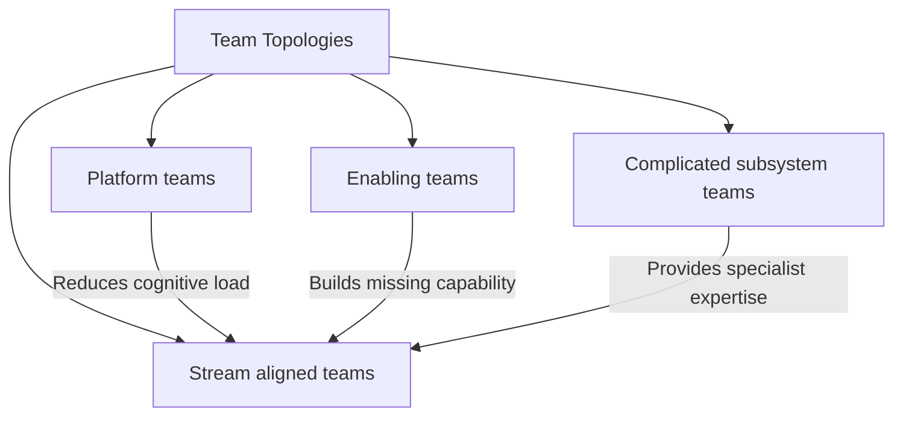

# Defining and Describing Team Topologies

- _Team Topologies is a practical model for structuring teams so value flows quickly without overwhelming people with unnecessary cognitive load._
- Team Topologies is an approach to organizing technology teams around value streams, team cognitive load, and explicitly designed team interactions. [^ra8m2d] It distinguishes four core team types: stream-aligned, platform, enabling, and complicated-subsystem teams. [^ra8m2d]
- A **stream-aligned team** owns a continuous flow of value associated with a business domain, product, customer journey, or other meaningful stream. [^df8x38]
- A **platform team** provides internal services that reduce the cognitive load of stream-aligned teams, allowing them to focus on customer and business outcomes. [^ra8m2d] [^df8x38]
- An **enabling team** helps other teams acquire missing skills or adopt new practices, while a **complicated-subsystem team** owns a technically specialized area that requires concentrated expertise. [^ra8m2d]
- The model applies especially when growing organizations experience slow delivery, unclear ownership, excessive dependencies, or teams burdened by systems and processes outside their core mission. [^3ro8vf] [^ra8m2d]

## Uses in Context

- **[[concepts/Organization Design|Organizational Design]]:** Leaders use the model to replace large, monolithic teams with smaller teams aligned to business domains and customer outcomes. [^df8x38] [^662d51]
- **[[concepts/Platform Strategy|Platform Strategy]]:** Platform teams are invoked as internal product teams whose purpose is to simplify delivery for stream-aligned teams rather than create another layer of infrastructure ownership. [^ra8m2d] [^df8x38]
- **Team interaction design:** The framework helps organizations deliberately choose how teams collaborate, including temporary enabling relationships and clearer service boundaries. [^3ro8vf]
- **[[Vocabulary/Cognitive Load|Cognitive Load]] management:** Practitioners use the term to describe reducing the number of unrelated systems, processes, and responsibilities each team must understand. [^3ro8vf] [^wz912e]
- **Scaling [[concepts/Product Development Workflow|Product Development Workflow]]:** Organizations apply Team Topologies to create small, cross-functional teams while retaining specialized platform or enabling capabilities. [^ra8m2d] [^qik0hc]

## History of Use

### Origins

The supplied search results do not establish the original publication date, first usage, or authorship of the term with sufficient primary-source evidence. They do, however, document the framework’s central vocabulary: stream-aligned teams, platform teams, enabling teams, complicated-subsystem teams, and team cognitive load. [^3ro8vf] [^ra8m2d] [^df8x38]

### Evolution

- **By the documented adoption cases:** Team Topologies evolved from a team-structure model into a broader operating approach that combines team boundaries, cognitive-load management, platform design, and intentional interactions. [^3ro8vf] [^ra8m2d]
- **October 2023:** Alfa Financial Software reorganized its engineering group into product areas aligned with core business domains, using Team Topologies principles to clarify ownership and reduce cognitive load. [^662d51]
- **Late 2019 onward:** loveholidays reorganized 130 data, product, and engineering staff into small, cross-functional “mission teams” of approximately five people, supported by dedicated platform teams. [^qik0hc]

## Best Real-World Examples

- [Creditas](https://teamtopologies.com/industry-examples/creditas-managing-team-cognitive-load-with-team-topologies-for-fast-flow-of-value) — used Lean Inception and mobile enabling teams to reduce process and technical cognitive load. [^3ro8vf]
- [Yassir](https://teamtopologies.com/industry-examples/yassir-transforming-a-super-app-with-team-topologies) — reorganized teams around business domains and customer personas instead of front-end and back-end specializations. [^df8x38]
- [Alfa Financial Software](https://teamtopologies.com/industry-examples/from-organic-growth-to-intentional-flow) — aligned product areas with customer-understood business domains to make team boundaries clearer. [^662d51]
- [loveholidays](https://teamtopologies.com/industry-examples/scaling-value-delivery-and-ai-native-engineering-through-team-topologies-at-loveholidays) — formed approximately five-person cross-functional mission teams and supported them with platform teams. [^qik0hc]
- [Pirate Ship Software](https://teamtopologies.com/industry-examples/reteaming-for-fast-flow-a-case-study-from-pirate-ship) — moved from overloaded feature teams to five stream-aligned teams and two platform teams. [^qrgx21]
- [REA Group Financial Services](https://teamtopologies.com/industry-examples/tag/REA) — restructured large, monolithic teams into smaller autonomous stream-aligned teams with a focus on flow efficiency and cognitive load. [^mb8fr0]

## Case Studies

**[[client-content/Hypernova/Files/Portfolio/Yassir|Yassir]].** Yassir shifted from siloed front-end and back-end groupings toward teams organized around business domains and customer personas. [^df8x38] In its mobility domain, for example, the structure included separate customer-experience and driver-experience teams. [^df8x38] The organization also developed platform capabilities intended to reduce infrastructure complexity for stream-aligned teams. [^df8x38] The case shows how Team Topologies can turn technical specialization into domain-oriented ownership, making team boundaries correspond more closely to customer value.

**loveholidays.** Beginning in late 2019, loveholidays reorganized a department of 130 data, product, and engineering staff around small, cross-functional mission teams of approximately five people. [^qik0hc] The teams were designed to reduce communication overhead, prevent internal silos, and accelerate the acquisition of relevant context. [^qik0hc] Dedicated platform teams supported the mission teams, creating aligned autonomy rather than simply distributing infrastructure responsibilities across every product group. [^qik0hc] The example illustrates the model’s use at meaningful organizational scale without abandoning small-team ownership.

**Pirate Ship Software.** Pirate Ship Software responded to scaling constraints and excessive cognitive load by moving away from overloaded feature teams toward smaller, focused units. [^qrgx21] Its redesign combined Team Topologies with Wardley Mapping and Domain-Driven Design, producing five stream-aligned teams and two platform teams. [^qrgx21] Each stream-aligned team received a clearly defined domain with understood boundaries and responsibilities. [^qrgx21] The case demonstrates that Team Topologies is often used as part of a broader architecture-and-organization design method rather than as a standalone restructuring checklist.

***

# Sources

[^3ro8vf]: 2026, Jul 25. [teamtopologies.com](https://teamtopologies.com/). [Creditas: Managing Team Cognitive Load with ...](https://teamtopologies.com/industry-examples/creditas-managing-team-cognitive-load-with-team-topologies-for-fast-flow-of-value). Updated: 2026, Oct 31. Generated: 2026, Nov 14. [Perplexity](https://www.perplexity.ai/) API response.
[^ra8m2d]: 2026, Aug 12. [teamtopologies.com](https://teamtopologies.com/). [Team Topologies - Organizing for fast flow of value](https://teamtopologies.com/home). Updated: 2026, Nov 10. Generated: 2026, Nov 14. [Perplexity](https://www.perplexity.ai/) API response.
[3]: 2026, Oct 31. [teamtopologies.com](https://teamtopologies.com/). [teamtopologies.com › industry-examples › tagStream-aligned teams — Industry Examples — Team Topologies](https://teamtopologies.com/industry-examples/tag/Stream-aligned%20teams). Generated: 2026, Nov 14. [Perplexity](https://www.perplexity.ai/) API response.
[^df8x38]: 2026, Apr 07. [teamtopologies.com](https://teamtopologies.com/). [Yassir: Transforming a Super App with Team Topologies](https://teamtopologies.com/industry-examples/yassir-transforming-a-super-app-with-team-topologies). Updated: 2026, Nov 06. Generated: 2026, Nov 14. [Perplexity](https://www.perplexity.ai/) API response.
[^wz912e]: 2026, Jul 25. [teamtopologies.com](https://teamtopologies.com/). [Team Cognitive Load — Industry Examples — Team Topologies - Organizing for fast flow of value](https://teamtopologies.com/industry-examples/tag/Team%20Cognitive%20Load). Updated: 2026, Oct 29. Generated: 2026, Nov 14. [Perplexity](https://www.perplexity.ai/) API response.
[^662d51]: 2026, Mar 17. [teamtopologies.com](https://teamtopologies.com/). [From Organic Growth to Intentional Flow: How Alfa ...](https://teamtopologies.com/industry-examples/from-organic-growth-to-intentional-flow). Updated: 2026, Nov 04. Generated: 2026, Nov 14. [Perplexity](https://www.perplexity.ai/) API response.
[7]: 2026, Oct 18. [teamtopologies.com](https://teamtopologies.com/). [Industry Examples — Team Topologies - Organizing for fast flow of value](https://teamtopologies.com/industry-examples?category=Software+Development). Updated: 2026, Oct 19. Generated: 2026, Nov 14. [Perplexity](https://www.perplexity.ai/) API response.
[^mb8fr0]: 2026, Mar 25. [teamtopologies.com](https://teamtopologies.com/). [REA — Industry Examples — Team Topologies - Organizing for fast ...](https://teamtopologies.com/industry-examples/tag/REA). Updated: 2026, Nov 14. Generated: 2026, Nov 14. [Perplexity](https://www.perplexity.ai/) API response.
[^qik0hc]: 2026, Oct 31. [teamtopologies.com](https://teamtopologies.com/). [Scaling Value Delivery and AI-Native Engineering through ...](https://teamtopologies.com/industry-examples/scaling-value-delivery-and-ai-native-engineering-through-team-topologies-at-loveholidays). Updated: 2026, Nov 05. Generated: 2026, Nov 14. [Perplexity](https://www.perplexity.ai/) API response.
[^qrgx21]: 2025, Nov 18. [teamtopologies.com](https://teamtopologies.com/). [Reteaming for Fast Flow: A Case Study from Pirate Ship ...](https://teamtopologies.com/industry-examples/reteaming-for-fast-flow-a-case-study-from-pirate-ship). Updated: 2026, Nov 01. Generated: 2026, Nov 14. [Perplexity](https://www.perplexity.ai/) API response.
