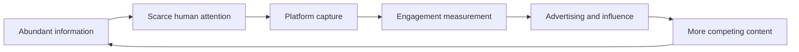

[[Vocabulary/Information Overload|Information Overload]]
[[Vocabulary/Cognitive Load|Cognitive Load]]
[[organizations/Facebook|Facebook]]
[[organizations/Meta|Meta]]
[[Instagram]]
[[Snap]]
[[Netflix]]
[[Sources/Media/YouTube|YouTube]]

# Defining and Describing The Attention Economy

- _The attention economy is the struggle to capture, hold, measure, and monetize the scarce resource of human attention._
- The concept describes an economic system in which information is abundant while human attention remains limited, making attention a valuable resource allocated among competing messages, platforms, and institutions.[^h7qwvc][^0rwpc1][^p15ja4]
- It applies especially to digital media, advertising, social networks, search, streaming, news, and interface design, where organizations optimize content and products for engagement.[^h7qwvc][^lj4zl7]
- Its central business logic is that platforms attract audiences, measure their behavior, and sell advertisers access to those audiences; the more attention a service captures, the more valuable its advertising inventory may become.[^h7qwvc][^h88oyv]
- The concept matters because systems designed to maximize engagement can reshape what people notice, how long they remain online, and which information becomes socially visible.[^2z23n1][^lj4zl7]

## Uses in Context

- **Business strategy:** The term describes markets in which companies compete to acquire and retain audience focus rather than merely sell products directly.[^h7qwvc][^h88oyv]
- **Platform design:** Product teams invoke it when discussing feeds, notifications, recommendations, autoplay, and other mechanisms intended to increase time spent or interaction.[^h7qwvc][^lj4zl7]
- **Advertising:** It frames advertising inventory as access to users’ limited attention, with behavioral data helping determine which audiences advertisers can reach.[^h7qwvc][^braq2z]
- **Media criticism:** Critics use the phrase to analyze how digital services convert attention, engagement, and personal data into commercial value.[^2z23n1][^lj4zl7]
- **Information overload:** The concept explains why a larger supply of information can produce a shortage of attention rather than greater public understanding.[^h7qwvc][^p15ja4]
- **Political communication:** Researchers apply it to the competition among parties, news organizations, influencers, and social movements for public salience.[^hfe9zj]

## History of Use

## Origins

- The intellectual foundation is Herbert A. Simon’s 1971 discussion of organizations in an information-rich environment. Simon argued that “a wealth of information creates a poverty of attention,” because information consumes the attention of its recipients.[^h7qwvc][^p15ja4]
- Simon treated attention primarily as an allocation problem created by information abundance, not initially as a digital advertising business model.[^h7qwvc][^0rwpc1]
- Michael Goldhaber’s 1997 essay “The Attention Economy and the Net” extended the idea to networked communication, arguing that attention—not money—would become the fundamental scarce resource of the internet economy.[^h7qwvc][^braq2z][^p15ja4]
- Thomas Davenport and John Beck’s 2001 book *[[Sources/Books/The Attention Economy (Book)]]* further developed the concept for management and business audiences, while Richard Lanham’s 2006 work connected attention to rhetoric and digital culture.[^p15ja4]

## Evolution

- **1971 — Information scarcity becomes attention scarcity:** Simon shifted analysis from the problem of too much information to the limited cognitive resource required to process it.[^h7qwvc][^p15ja4]
- **1997 — Attention becomes an internet-economic theory:** Goldhaber argued that falling communication costs would not eliminate scarcity, because human time and attention would remain constrained.[^h7qwvc][^braq2z]
- **1995–2005 — Advertising platforms operationalize the concept:** Search, social, video, and microblogging services developed models built around capturing user attention, measuring engagement, and selling targeted access to audiences.[^h7qwvc]
- **2016–2020 — The concept becomes a public critique of persuasive technology:** Tristan Harris’s warnings about technology’s effects on human behavior and the documentary *The Social Dilemma* helped make attention-capture design a mainstream ethical concern.[^h7qwvc]

## Best Real-World Examples

- [Google Search](https://www.google.com) exemplifies intent-based attention capture by presenting advertising when users are actively seeking information.[^h7qwvc]
- [Facebook](https://www.facebook.com) illustrates a feed model that seeks to maximize time, interaction, and audience exposure for advertising.[^h7qwvc]
- [YouTube](https://www.youtube.com) demonstrates watch-time optimization, with recommendations and video sequencing competing for sustained viewing.[^h7qwvc]
- [Twitter/X](https://x.com) exemplifies engagement-driven distribution through likes, shares, follows, and promoted posts.[^h7qwvc]
- [Netflix](https://www.netflix.com) represents subscription streaming’s competition for viewing time, even though its primary revenue model differs from advertising.[^lj4zl7]
- [TikTok](https://www.tiktok.com) illustrates highly personalized short-form content delivery designed around continuous interaction and rapid attention shifts.[^lj4zl7]
- [The Social Dilemma](https://www.thesocialdilemma.com) popularized the idea that digital platforms engineer products around the capture and monetization of attention.[^h7qwvc]

## Case Studies

### Search advertising

Google’s search model illustrates how the attention economy converts a moment of user intent into commercial value. Search platforms identify what a person is seeking, present relevant results and advertisements, and charge advertisers for access to users at that moment of attention.[^h7qwvc] The important innovation was not simply displaying advertisements, but linking advertising value to measurable user behavior such as queries and clicks.[^h7qwvc][^braq2z] This case shows how attention can be valuable not only because of its duration, but also because of its context and apparent commercial intent.

### Social-feed optimization

Facebook’s model demonstrates the shift from publishing content to continuously optimizing an environment for engagement. The platform’s business logic has been described as maximizing time on the service and selling access to the resulting audience.[^h7qwvc] More broadly, platformized cultural industries treat attention as an asset that can be quantified and managed through user-generated data, rather than as a fixed commodity exchanged independently of the platform.[^2z23n1] The case shows how ranking systems transform individual acts—scrolling, reacting, sharing, and returning—into economic signals.

### Engagement-driven information environments

The broader social-media ecosystem demonstrates the attention economy’s societal consequences. Digital surfaces increasingly measure and optimize content through engagement metrics while competing continuously for attention across the day.[^lj4zl7] This environment can fragment information into small, rapidly delivered units and encourage designs that prioritize capture and retention over deliberation.[^lj4zl7] The result is a system in which attention functions simultaneously as a scarce cognitive resource, a measurable behavioral signal, and a monetizable platform asset.[^2z23n1][^0rwpc1]

***

# Sources

[1]: [Attention as Universal Currency: Second Wave of Attention Economy](https://studylib.net/doc/28744502/heitmayer-second-wave-of-attention--published)
[^h7qwvc]: [The Attention Economy – Geschichte der Informatik](https://www.geschichte-der-informatik.de/articles/the_attention_economy/)
[^braq2z]: [Big tech profited from our attention – now AI wants to mo...](https://observer.co.uk/news/columnists/article/big-tech-profited-from-our-attention-now-ai-wants-to-monetise-intentions)
[^2z23n1]: [Full article: This is a Popularity Contest: Exploring the ...](https://www.tandfonline.com/doi/full/10.1080/00380237.2026.2627650)
[^0rwpc1]: [Rethinking the cognitive foundations of the attention economy](https://researchprofiles.ku.dk/en/publications/rethinking-the-cognitive-foundations-of-the-attention-economy/)
[^hfe9zj]: [The Political Economy of Attention: Media Salience, Voter ...](https://onlinelibrary.wiley.com/doi/full/10.1111/joes.70051)
[^h88oyv]: [Africa's Attention Economy: The Case for Digital Sovereignty - AJSD](https://www.ajsd.org/africas-attention-economy-the-case-for-digital-sovereignty/)
[^lj4zl7]: [www.cambridge.org › core › journalsCognitive overload in the Attention Economy | The British ...](https://www.cambridge.org/core/journals/the-british-journal-of-psychiatry/article/cognitive-overload-in-the-attention-economy/B4727BB84CA2F93E53ACECCEE9C8ABD4)
[^p15ja4]: [The Attention Economy - Cyborg Anthro Wiki](https://cyborganthropology.com/index.php/The_Attention_Economy)
[10]: [What Is the Attention Economy? - Neurosity](https://neurosity.co/guides/attention-economy-explained)
