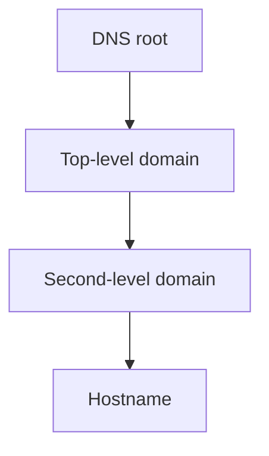

---
aliases:
  - gTLD
  - gTLDs
  - TLD
  - TLDs
  - Top Level Domain
date_created: 2026-11-06
date_modified: 2026-11-06
site_uuid: c6da2edd-6004-4604-9eae-a5a95b14ae41
publish: true
title: Top Level Domains
slug: top-level-domains
at_semantic_version: 0.0.0.1
cf_last_run: 2026-11-06T17:17:33.349Z
cf_last_run_model: Perplexity sonar-pro
tags:
  - Cloud-Infrastructure
  - Internet-Everywhere
---

# Defining and Describing Top Level Domains

- [IMAGE 1: Diagram of the DNS hierarchy showing the root zone, top-level domains, second-level domains, and hostnames]

_Top-level domains are the Internet’s highest named layer—the endings that organize domains into broad administrative, geographic, infrastructural, or community categories._

A **top-level domain (TLD)** is the rightmost label in a fully qualified domain name, such as `.com` in `example.com` or `.uk` in `example.co.uk`. [^c759mr] TLDs sit directly below the DNS root and above second-level domains; the DNS specification represents domain names as a hierarchy of labels separated by dots. [^c759mr] [^89e7ao] They matter because only TLDs delegated into the Internet’s root zone can normally support publicly resolvable domains. [^d9zjt5]

## Uses in Context

- **Address classification:** `.com`, `.org`, and `.net` traditionally signal commercial, organizational, and network-related purposes, although modern registration policies are often broader. [^fzun28] [^d9zjt5]
- **Geographic identity:** Two-letter country-code TLDs, such as `.uk`, `.jp`, and `.fr`, identify national or territorial namespaces. [^x7468a] [^89e7ao]
- **Institutional restriction:** `.gov`, `.mil`, and `.edu` are associated with restricted government, military, and higher-education use cases. [^fzun28] [^ts9l73]
- **Branding and product positioning:** Newer generic TLDs include strings such as `.app`, `.blog`, and `.shop`, allowing organizations to incorporate category terms into domain names. [^8lcdk7] [^ts9l73]
- **Technical infrastructure:** `.arpa` is an infrastructure TLD used within the DNS rather than as a general-purpose namespace. [^qpzni9]
- **Community and policy coordination:** Country-code registry managers collaborate through ICANN’s Country Code Names Supporting Organization, or ccNSO. [^w2iayl]

# History of Use

## Origins

- The DNS hierarchy was formally specified in the early Internet standards, including RFC 1034, which defines a domain as a sequence of labels organized into subdomains. [^c759mr]
- The first widely recognized TLD set emerged during the 1980s under the coordination of IANA, then associated with Jon Postel’s Internet naming work. [^fzun28]
- `.com` was implemented on January 1, 1985, alongside early namespaces such as `.gov`, `.edu`, `.mil`, `.org`, `.net`, `.int`, and `.bitnet`. [^fzun28]

## Evolution

- **1985:** The original generic namespaces established functional categories for commercial, nonprofit, network, governmental, educational, military, and international domains. [^fzun28]
- **2000–2004:** ICANN expanded the generic namespace through additions including `.aero`, `.biz`, `.coop`, `.info`, `.museum`, `.name`, `.pro`, `.asia`, `.cat`, `.jobs`, `.mobi`, `.tel`, and `.travel`. [^d9zjt5]
- **2012–2013:** ICANN’s New gTLD Program introduced the first broad, systematic expansion; it received 1,930 applications in 2012, with delegations beginning in 2013. [^d9zjt5] The expansion added brand, geographic, community, and generic-word strings, taking the root zone to more than a thousand extensions. [^8lcdk7] [^d9zjt5]

# Best Real-World Examples

- [.com](https://www.icannwiki.org/index.php?title=.com) — the legacy commercial TLD implemented in 1985 and one of the first DNS namespaces. [^fzun28]
- [.org](https://www.iana.org/domains/root/db/org.html) — an early generic namespace historically associated with organizations. [^fzun28]
- [.uk](https://www.iana.org/domains/root/db/uk.html) — a country-code TLD representing the United Kingdom. [^89e7ao]
- [.cat](https://www.iana.org/domains/root/db/cat.html) — a sponsored or community-oriented TLD created during the expansion of specialized namespaces. [^d9zjt5]
- [.app](https://www.iana.org/domains/root/db/app.html) — a newer generic TLD associated with applications and digital products. [^ts9l73]
- [.arpa](https://www.iana.org/domains/root/db/arpa.html) — the infrastructure TLD used for specialized DNS functions. [^qpzni9]
- [IANA Root Zone Database](https://www.iana.org/domains/root/db) — the registry of TLD delegations and their authoritative administrative information. [^x7468a] [^qpzni9]

# Case Studies

The `.com` namespace illustrates how a narrowly defined technical category became a dominant public convention. It was delegated in 1985 as part of the first generation of generic TLDs, when domain endings were intended to signal broad organizational roles. [^fzun28] As commercial Internet use expanded, `.com` became a general-purpose identity marker rather than a tightly enforced classification. Its history shows that a TLD’s social meaning can broaden beyond its original administrative intent. [^fzun28]

The New gTLD Program demonstrates how governance can turn a small namespace into a large naming market. ICANN’s 2012 round accepted 1,930 applications covering generic terms, geographic names, communities, and brands, with delegations beginning in 2013. [^d9zjt5] More than 1,200 new generic TLDs were subsequently introduced, substantially expanding the available naming vocabulary. [^8lcdk7] The case shows that TLDs are not merely technical suffixes: they are policy-created resources whose availability reflects institutional rules, applicant competition, and registry operations. [^8lcdk7] [^d9zjt5]

Country-code TLDs illustrate a different model of namespace administration. Unlike generic TLDs, they are organized around two-letter country or territory codes and are managed within national or territorial policy environments. [^x7468a] [^89e7ao] ICANN’s ccNSO provides a forum for ccTLD managers to coordinate on globally relevant issues. [^w2iayl] This model shows that the DNS hierarchy combines global technical coordination with locally varied rules for registration, eligibility, and dispute resolution. [^w2iayl] [^89e7ao]

***

# Sources

[^c759mr]: 2026, Nov 06. [rfc-editor.org](https://www.rfc-editor.org/). [RFC 1034: Domain names - concepts and facilities](https://www.rfc-editor.org/info/rfc1034/). Generated: 2026, Nov 06. [Perplexity](https://www.perplexity.ai/) API response.
[^8lcdk7]: 2026, Oct 29. [ca.finance.yahoo.com](https://ca.finance.yahoo.com/). [ICANN Marks International Internet Day, Recognizing 57 ...](https://ca.finance.yahoo.com/news/icann-marks-international-internet-day-143000079.html). Updated: 2026, Nov 05. Generated: 2026, Nov 06. [Perplexity](https://www.perplexity.ai/) API response.
[^x7468a]: 2026, Oct 27. [namoly.io](https://namoly.io/). [How many TLDs exist? We counted IANA’s files · Namoly](https://namoly.io/resources/how-many-domain-extensions-are-there). Updated: 2026, Oct 31. Generated: 2026, Nov 06. [Perplexity](https://www.perplexity.ai/) API response.
[^w2iayl]: 2025, Nov 14. [icann.org](https://www.icann.org/). [Timeline and History](https://www.icann.org/en/ccnso/timeline-and-history). Updated: 2026, Oct 09. Generated: 2026, Nov 06. [Perplexity](https://www.perplexity.ai/) API response.
[^fzun28]: 2026, Oct 12. [icannwiki.org](https://icannwiki.org/). [.com](https://icannwiki.org/index.php?title=.com&veaction=edit&section=13). Updated: 2026, Oct 30. Generated: 2026, Nov 06. [Perplexity](https://www.perplexity.ai/) API response.
[^qpzni9]: 2026, Sep 23. [w.is](https://w.is/). [TLD List: All Domain Extensions with WHOIS & RDAP | W.is](https://w.is/tld). Updated: 2026, Oct 30. Generated: 2026, Nov 06. [Perplexity](https://www.perplexity.ai/) API response.
[^d9zjt5]: 2026, Oct 30. [pitch.law](https://www.pitch.law/). [History of ICANN's New gTLD Program | Pitch](https://www.pitch.law/academy/history-and-background). Updated: 2026, Nov 01. Generated: 2026, Nov 06. [Perplexity](https://www.perplexity.ai/) API response.
[^89e7ao]: 2026, Jun 26. [dev.to](https://dev.to/). [How the Web Stays Connected](https://dev.to/jinkrish/how-the-web-stays-connected-3200). Updated: 2026, Oct 01. Generated: 2026, Nov 06. [Perplexity](https://www.perplexity.ai/) API response.
[^ts9l73]: 2026, Mar 15. [futurescope.co](https://www.futurescope.co/). [Who Owns the Internet? The Truth About ICANN](https://www.futurescope.co/who-owns-the-internet-the-truth-about-icann/). Updated: 2026, Mar 25. Generated: 2026, Nov 06. [Perplexity](https://www.perplexity.ai/) API response.
[10]: 2026, Nov 06. [labs.ripe.net](https://labs.ripe.net/). [ADoX Deployment in the Wild - RIPE Labs](https://labs.ripe.net/author/yevheniya-nosyk/adox-deployment-in-the-wild/). Generated: 2026, Nov 06. [Perplexity](https://www.perplexity.ai/) API response.
