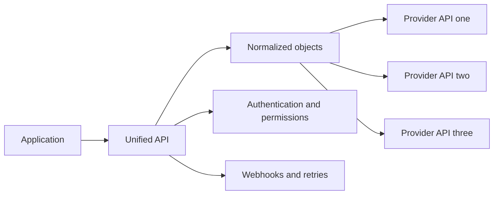

[[REST API]]

Examples include [[Metriport]].

[[The Design of Web APIs]].

[[Fast API]]

# Defining and Describing Unified API

- _A unified API turns many provider-specific integrations into one interface that software can build against._
- A unified API is a single interface for accessing multiple third-party APIs while presenting consistent methods and data models. [^y3uv8p] [^2z76ji] It commonly abstracts authentication, authorization, schema normalization, data synchronization, webhooks, rate limits, retries, and provider-specific API calls. [^y3uv8p] [^y1ecok]
- The concept applies when a product must connect to several services in the same category—such as CRM, accounting, calendar, recruiting, communication, or AI providers—without maintaining a separate integration layer for each vendor. [^y3uv8p] [^fbmwx0]
- Its value is reduced integration code and maintenance: developers implement against one normalized surface while the unified provider translates requests and responses for each underlying API. [^y3uv8p] [^3c3qb5]

## Uses in Context

- **Embedded integrations:** SaaS products use a unified API to let their customers connect services such as Salesforce, HubSpot, Pipedrive, Jira, or Slack without separately building every connector. [^y3uv8p] [^p42ta7]
- **Data normalization:** The phrase describes a layer that maps different vendor schemas into common objects such as contacts, deals, employees, invoices, or calendar events. [^2z76ji] [^3c3qb5]
- **Authentication orchestration:** Unified APIs are invoked to centralize OAuth flows, token refresh, permissions, and provider-specific authorization details. [^p42ta7] [^y1ecok]
- **Operational integration infrastructure:** The term can include webhook relay, retries, rate-limit handling, synchronization, observability, and raw-payload passthrough. [^y3uv8p] [^b6an6u]
- **AI model routing:** More recent projects use “unified API” for a gateway that exposes many AI providers through one interface, sometimes using an OpenAI-compatible request format. [^tj471p]
- **Self-hosted alternatives:** Open-source projects use the term for vendor-neutral APIs placed in front of several services, such as Google, Microsoft, and Apple calendars. [^fbmwx0]

## History of Use

### Origins

- The term does not have a single universally recognized originating paper or inventor in the available sources. Contemporary descriptions treat “unified API,” “universal API,” “integration hub,” and “API aggregator” as overlapping names for an abstraction over multiple third-party APIs. [^2z76ji] [^y1ecok]
- The earliest clearly documented commercial wave identified in the available material emerged around **2019–2020**, with startups including Merge, Apideck, and Finch. [^y3uv8p] This history supports attributing the modern category primarily to integration-focused startups rather than to large incumbent platforms.

### Evolution

- **2019–2020 — Commercial integration platforms:** Startups began packaging normalized objects, authentication, and connector maintenance as a reusable product, making unified APIs a distinct infrastructure category for embedded SaaS integrations. [^y3uv8p]
- **2020s — Broader platform capabilities:** Unified APIs expanded beyond endpoint translation to include webhooks, permissions, retries, synchronization, observability, and optional access to provider-specific fields. [^y3uv8p] [^b6an6u] [^3c3qb5]
- **Mid-2020s — Open-source and AI gateway variants:** Open-source projects applied the pattern to calendars, CRM systems, and AI providers, while self-hosted gateways increasingly emphasized routing many models through one interface. [^tj471p] [^fbmwx0] [^p42ta7]

## Best Real-World Examples

- [Merge](https://merge.dev/) — Representative early unified-API startup associated with the 2019–2020 commercial wave. [^y3uv8p]
- [Apideck](https://www.apideck.com/) — Unified integration platform associated with normalized access to multiple business-software providers. [^y3uv8p]
- [Finch](https://www.tryfinch.com/) — Early unified-API company focused on connecting employment and payroll systems. [^y3uv8p]
- [Revert](https://github.com/api-evangelist/revert) — Open-source platform exposing CRM, ticketing, accounting, and communication services through standardized interfaces, with OAuth and retry support. [^p42ta7]
- [Caldera](https://github.com/7GMA/caldera) — Open-source calendar API that places Google Calendar, Microsoft Outlook, and Apple iCloud behind one vendor-neutral REST API. [^fbmwx0]
- [Unified.to](https://unified.to/) — Commercial platform emphasizing normalized objects, endpoints, scopes, errors, and raw payload access across many integrations. [^b6an6u]
- [Uni-API](https://github.com/monologue82/Uni-API) — Self-hosted gateway routing requests to dozens of AI providers through a common interface. [^tj471p]

## Case Studies

**Revert and open-source embedded integrations.** Revert presents a unified API for CRM, ticketing, accounting, chat, and related categories, allowing developers to authenticate once per tenant and work with normalized data across supported providers. [^p42ta7] Its implementation also includes OAuth management, token refresh, and retry logic, demonstrating that the concept is more than merely renaming endpoints: it centralizes recurring integration infrastructure. [^p42ta7] The case shows how open-source projects can make a category accessible to teams that want control over deployment, customization, or vendor dependence.

**Caldera and calendar portability.** Caldera places Google Calendar, Microsoft Outlook, and Apple iCloud behind a single vendor-neutral HTTP API. [^fbmwx0] Applications can connect a calendar account once and use identical endpoints for reading, writing, searching, and synchronizing events rather than implementing provider-specific SDK and OAuth paths. [^fbmwx0] The example illustrates the core design trade-off: a unified abstraction simplifies application development, while the platform must reconcile differences among providers’ authentication, event models, and capabilities.

**Unified.to and the normalized-plus- passthrough model.** Unified.to describes a more mature architecture in which endpoints, objects, scopes, errors, and authorization are normalized while raw provider payloads remain available when integrations require vendor-specific fields. [^b6an6u] Its broader design separates common functionality from provider-specific escape hatches, addressing a central limitation of strict normalization: a common schema improves portability but can discard features that exist only in one provider. The case shows how unified APIs evolved from simple aggregation toward a layered contract combining portability with controlled access to native capabilities. [^b6an6u] [^3c3qb5]

***

# Sources

[^y3uv8p]: [What is a unified API? | Nango Blog](https://nango.dev/blog/what-is-a-unified-api/)
[^tj471p]: [GitHub - monologue82/Uni-API: A unified API gateway for the ...](https://github.com/monologue82/Uni-API)
[^2z76ji]: [Glossary - Unified api](https://docs.unified.to/concepts/glossary/unified_api)
[^b6an6u]: [Unified.to — Real-time Unified API & MCP Platform](https://unified.to/?ref=finderlaunch)
[5]: [JOINAPIintegration&MCPserver](https://unified.to/integrations/join)
[^3c3qb5]: [Embedded iPaaS vs Unified APIs: How to Choose in 2026](https://unified.to/blog/embedded_ipaas_vs_unified_apis_how_to_choose_in_2026)
[^fbmwx0]: [github.com › 7GMA › calderaGitHub - 7GMA/caldera: Open-source unified REST API for ...](https://github.com/7GMA/caldera)
[^p42ta7]: [api-evangelist/revert: Revert — independent ...](https://github.com/api-evangelist/revert)
[9]: [What Unified API Solutions Support a Large Number of](https://unified.to/blog/what_unified_api_solutions_support_a_large_number_of_integrations)
[^y1ecok]: [README.md - api-evangelist/unified-apis - GitHub](https://github.com/api-evangelist/unified-apis/blob/main/README.md)
