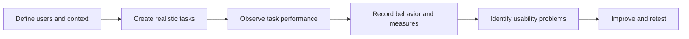

# Defining and Describing Usability Testing

_Usability testing reveals what people actually do when they try to accomplish realistic goals with a product._

Usability testing is an empirical research method in which representative users attempt realistic tasks while a facilitator observes their behavior, difficulties, errors, and completion outcomes. [^74uruq] [^gkeui8] It applies to websites, applications, software, physical products, and services, especially when teams need evidence about whether a design works for specified users in a defined context. [^74uruq] [^edbeq4] Under ISO 9241-11, usability concerns whether users achieve specified goals with effectiveness, efficiency, and satisfaction. [^74uruq] [^edbeq4]

## Uses in Context

- **[[Product Design]]:** Teams observe target users interacting with prototypes or finished products to identify confusing flows, navigation problems, and unmet expectations. [^gkeui8] [^3dolrd]
- **[[Vocabulary/Software Development|Software Development]]:** Researchers assess whether users can complete representative workflows, recording task success, time, errors, and satisfaction. [^edbeq4] [^v581m7]
- **Formative research:** A test is used diagnostically to “find and understand problems” so that a design can be improved. [^gkeui8]
- **Summative evaluation:** A test measures how well a product accomplishes its intended goals, often using quantitative benchmarks such as completion rates and time on task. [^wy0emh] [^gkeui8]
- **Accessibility and inclusion:** Testing with people who have relevant disabilities or assistive-technology needs can expose barriers that conventional testing misses. [^3dolrd]
- **Research communication:** The phrase often distinguishes observed behavior from stated preference: practitioners emphasize learning from “what participants do, not what they say they would do.” [^gkeui8]

## History of Use

### Origins

Usability testing emerged from human–computer interaction and human-factors research rather than from a single modern technology company. Its intellectual basis lies in evaluating systems through representative users, realistic tasks, and observable performance; later practitioner frameworks formalized the distinction between diagnostic formative testing and measurement-oriented summative testing. [^wy0emh] [^74uruq] Clayton Lewis is associated with introducing think-aloud usability methods at IBM in the early 1980s, while Jakob Nielsen helped popularize the approach among practitioners. [^34cqij]

### Evolution

- **Early 1980s:** Clayton Lewis applied the think-aloud protocol to usability work at IBM, enabling researchers to capture users’ verbalized reasoning while they performed tasks. [^34cqij]
- **1990s:** Usability practice increasingly separated **formative** evaluation, intended to discover and fix problems, from **summative** evaluation, intended to measure performance against goals. [^wy0emh]
- **2010s–2020s:** Remote, unmoderated, prototype-based, and quantitative testing expanded the method beyond laboratory studies, while ISO 9241-11 continued to frame evaluation around effectiveness, efficiency, satisfaction, users, goals, and context. [^74uruq] [^edbeq4] [^gkeui8]

## Best Real-World Examples

- [Nielsen Norman Group](https://www.nngroup.com/) — helped popularize practitioner-oriented usability testing and the use of small, iterative studies in product design. [^34cqij]
- [IBM](https://www.ibm.com/) — served as an early institutional setting for Clayton Lewis’s think-aloud usability work in the 1980s. [^34cqij]
- [ISO 9241-11](https://www.iso.org/standard/63500.html) — provides the widely used effectiveness, efficiency, and satisfaction framework for defining usability. [^74uruq] [^edbeq4]
- [System Usability Scale](https://www.usability.gov/how-to-and-tools/methods/system-usability-scale.html) — exemplifies the use of standardized questionnaires to quantify perceived usability after interaction. [^34cqij]
- [Figma](https://www.figma.com/) — represents the prototype-centered workflow in which interfaces can be tested before implementation; prototype testing is commonly used to identify design problems early. [^74uruq] [^gkeui8]
- [Mozilla Firefox](https://www.mozilla.org/firefox/) — exemplifies an open-source product category where usability studies can inform navigation, onboarding, and accessibility improvements. [^3dolrd]
- [UserTesting](https://www.usertesting.com/) — represents the commercial remote-testing model, in which organizations recruit target users and observe task attempts outside a traditional laboratory. [^3dolrd] [^5wh9ay]

## Case Studies

**IBM and think-aloud testing.** In the early 1980s, Clayton Lewis developed think-aloud applications for usability work at IBM, asking users to verbalize their reasoning while completing tasks. [^34cqij] The method connected observable behavior with users’ moment-to-moment interpretations, helping researchers diagnose not only that an error occurred but why the interface produced it. [^34cqij] Its broader lesson is that usability testing is most valuable when observation is structured around realistic activity rather than post hoc opinion.

**Formative versus summative evaluation.** Contemporary usability practice distinguishes formative testing from summative testing: formative studies diagnose problems and guide redesign, whereas summative studies estimate how effectively and efficiently a product supports its goals. [^wy0emh] [^gkeui8] A team might therefore run short prototype sessions to discover navigation failures, then conduct a later benchmark study using task success, completion time, errors, and satisfaction. [^edbeq4] [^gkeui8] [^v581m7] This progression shows that usability testing is not one fixed procedure but a family of methods selected according to the decision the team must make.

**Remote and quantitative testing.** Modern usability testing frequently combines moderated or unmoderated remote sessions with behavioral metrics and standardized satisfaction measures. [^edbeq4] [^gkeui8] [^3dolrd] Researchers can recruit participants who match the target audience, assign realistic scenarios, observe points of hesitation or failure, and compare results across designs or releases. [^gkeui8] [^3dolrd] The shift demonstrates how the concept has expanded from laboratory diagnosis into an iterative product-development practice while retaining its central commitment to evidence from users’ actual task performance.

# Images

_Source: https://www.uxtigers.com/post/user-testing_

_Source: https://www.linkedin.com/pulse/step-by-step-guide-usability-testing-curated-sample_

_Source: https://ui-patterns.com/blog/usability-testing_

_Source: https://www.tricentis.com/learn/usability-testing_

_Source: https://www.softcrylic.com/blogs/usability-testing-process-test-methods/_

***

# Sources

[^wy0emh]: 2026, Jul 01. [onlinelibrary.wiley.com](https://onlinelibrary.wiley.com/). [Unraveling Usability: An In‐Depth Framework of Constructs ...](https://onlinelibrary.wiley.com/doi/10.1002/hfm.70050). Updated: 2026, Oct 29. Generated: 2026, Nov 14. [Perplexity](https://www.perplexity.ai/) API response.
[2]: 2026, Nov 11. [scribd.com](https://www.scribd.com/). [Inte Iso Iec 9241 210 2019 | PDF](https://www.scribd.com/document/1058452017/952111343-INTE-ISO-IEC-9241-210-2019). Generated: 2026, Nov 14. [Perplexity](https://www.perplexity.ai/) API response.
[^74uruq]: 2026, Oct 10. [next-levels.de](https://next-levels.de/). [Usability test: definition, methods & process](https://next-levels.de/en/wiki/usability-test). Updated: 2026, Nov 01. Generated: 2026, Nov 14. [Perplexity](https://www.perplexity.ai/) API response.
[^edbeq4]: 2026, Nov 08. [uxia.app](https://www.uxia.app/). [Software Usability Testing: Methods, Metrics and Workflow | Uxia](https://www.uxia.app/blog/software-usability-testing). Updated: 2026, Nov 13. Generated: 2026, Nov 14. [Perplexity](https://www.perplexity.ai/) API response.
[5]: 2026, Jul 22. [ficilcom.jp](https://www.ficilcom.jp/). [What Is Usability? Evaluation and Improvement | Xtrategy](https://www.ficilcom.jp/en/blog/usability). Updated: 2026, Oct 13. Generated: 2026, Nov 14. [Perplexity](https://www.perplexity.ai/) API response.
[^gkeui8]: 2026, Oct 30. [ui-patterns.com](https://ui-patterns.com/). [Usability Testing: Methods, Example Tasks and How Many Users](https://ui-patterns.com/blog/usability-testing). Updated: 2026, Nov 13. Generated: 2026, Nov 14. [Perplexity](https://www.perplexity.ai/) API response.
[^3dolrd]: 2026, Nov 11. [virtuosoqa.com](https://www.virtuosoqa.com/). [Usability Testing: Types, Process, and Best Practices](https://www.virtuosoqa.com/testing-guides/usability-testing). Updated: 2026, Nov 06. Generated: 2026, Nov 14. [Perplexity](https://www.perplexity.ai/) API response.
[^34cqij]: 2026, Jun 01. [buildwithaitoday.com](https://buildwithaitoday.com/). [What Usability Testing Actually Measures - Build with AI Today](https://buildwithaitoday.com/track/usability-testing-methods/learn/utm-what_is_usability_testing). Updated: 2026, Oct 20. Generated: 2026, Nov 14. [Perplexity](https://www.perplexity.ai/) API response.
[^v581m7]: 2026, Oct 06. [mutqansoft.sa](https://www.mutqansoft.sa/). [Usability Testing — Tasks, Participants, Think-Aloud and Measures](https://www.mutqansoft.sa/tools/qa/roadmap/usability-testing). Updated: 2026, Oct 15. Generated: 2026, Nov 14. [Perplexity](https://www.perplexity.ai/) API response.
[^5wh9ay]: 2026, Sep 28. [netguru.com](https://www.netguru.com/). [Usability testing: A practitioner's guide to running it right](https://www.netguru.com/blog/usability-testing-guide). Updated: 2026, Nov 10. Generated: 2026, Nov 14. [Perplexity](https://www.perplexity.ai/) API response.
