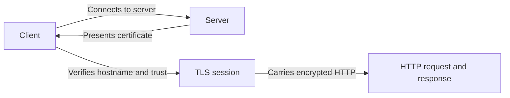

[[essays/Web Security is about Preventing Naivety|Web Security is about Preventing Naivety]]

https://youtu.be/NjDuchOJvWk?is=4tD7fTv5ctT8CCve

https://youtu.be/hWyBeEF3CqQ?si=U2fnVdw1Ghx3Okvt

# Defining and Describing HTTPS

- [IMAGE 1: Browser address bar displaying a padlock and an HTTPS URL]
- _HTTPS is HTTP delivered through an authenticated, encrypted TLS connection rather than as readable plaintext._ It is one of the primary [[Web Standards]].
- HTTPS stands for **Hypertext Transfer Protocol Secure** and describes ordinary HTTP traffic carried over [[projects/Emergent-Innovation/Standards/Transport Layer Security|Transport Layer Security]] (TLS), formerly Secure Sockets Layer (SSL).[^i7ems5][^ph3isu] It protects confidentiality and integrity in transit and allows a client to verify that it is communicating with the server named in the certificate.[^i7ems5][^1nmcen] HTTPS commonly uses TCP port 443, although deployments can use other ports.[^ph3isu]
- HTTPS matters whenever a browser or application exchanges credentials, payment information, personal data, or any other traffic that should not be exposed or altered between endpoints.[^0e8guj][^ph3isu]

# Uses in Context

- **Secure web browsing:** “HTTPS” in a URL indicates that HTTP is being transported through TLS rather than sent as unencrypted traffic.[^i7ems5][^ph3isu]
- **Authentication:** The client checks whether the server certificate corresponds to the requested hostname, helping prevent an impostor from presenting a certificate for another site.[^1nmcen]
- **Confidentiality:** TLS encrypts application data after the connection is established, preventing ordinary network observers from reading the HTTP contents.[^0e8guj][^ph3isu]
- **Integrity:** HTTPS is used to detect modification of transmitted messages while they are in transit.[^i7ems5][^ph3isu]
- **E-commerce and account access:** HTTPS was initially applied to protect transactions involving credit-card data and later became standard for password submission and private communications.[^0e8guj]
- **Protocol engineering:** “HTTP over TLS” is the standards-oriented phrase used to describe the relationship between HTTP and the transport-security layer.[^i7ems5][^1nmcen]

# History of Use

## Origins

- Netscape Communications developed SSL in the mid-1990s for secure web commerce; Taher Elgamal, then the company’s chief scientist, is credited with leading the SSL design effort.[^0e8guj][^oxfx5u]
- Netscape’s early commercial use case was protecting credit-card transactions in its Commerce Server, at a time when ordinary HTTP transmitted web data in plaintext.[^0e8guj]
- HTTPS was later standardized as a method for using TLS to secure HTTP in **RFC 2818**, published in May 2000.[^i7ems5][^oxfx5u]

## Evolution

- **1994–1996:** Netscape introduced SSL for web communications, and SSL 3.0 addressed important weaknesses in SSL 2.0.[^0e8guj]
- **1999:** The IETF’s successor protocol, TLS 1.0, replaced the SSL branding and became the open-standard lineage used by HTTPS.[^0e8guj][^cu7r19]
- **2008–2018:** TLS 1.2 added stronger cryptographic options, while TLS 1.3 removed several obsolete algorithms and simplified the handshake to reduce connection latency.[^0e8guj]

# Best Real-World Examples

- [Netscape Commerce Server](https://www.geschichte-der-informatik.de/articles/fun_fact_ssl_https_netscape/) — an early commercial HTTPS use case for protecting credit-card transactions.[^0e8guj]
- [Netscape Navigator](https://www.geschichte-der-informatik.de/articles/fun_fact_ssl_https_netscape/) — an early browser implementation associated with SSL-based secure web access.[^0e8guj]
- [Let’s Encrypt](https://letsencrypt.org/) — the free, automated certificate-authority model that helped lower the operational barrier to HTTPS adoption.[^gmx4ad]
- [Firefox telemetry](https://blog.mozilla.org/security/) — browser measurement used to track the growing share of encrypted web traffic.[^gmx4ad]
- [RFC 2818](https://www.rfc-editor.org/rfc/rfc2818) — the IETF specification describing how HTTP operates over TLS.[^i7ems5][^1nmcen]
- [TLS 1.3](https://www.rfc-editor.org/rfc/rfc8446) — the modern TLS generation associated with a shorter, more secure handshake design.[^0e8guj]

# Case Studies

Netscape’s mid-1990s SSL work demonstrates how HTTPS emerged from a concrete startup-era web problem: commercial websites needed to protect payment details while the broader web still used plaintext HTTP.[^0e8guj] Taher Elgamal and colleagues designed SSL for Netscape products, and the company applied it to Commerce Server and its browser ecosystem.[^0e8guj][^oxfx5u] The episode shows that HTTPS was not originally a generic “browser security” slogan; it was a practical protocol response to the risks of early electronic commerce.[^0e8guj]

The IETF’s standardization of TLS illustrates how a proprietary implementation became an interoperable Internet protocol.[^0e8guj][^cu7r19] TLS 1.0 followed SSL under a new name in 1999, and RFC 2818 subsequently documented the use of TLS for HTTP, including certificate and hostname-validation behavior.[^i7ems5][^1nmcen][^cu7r19] This transition shows the division of labor between an originating product company and an open standards community: Netscape popularized the initial mechanism, while the IETF standardized its successor.[^0e8guj][^i7ems5]

Let’s Encrypt represents a later adoption inflection point rather than the invention of HTTPS. Its free and automated certificate model reduced the cost and administrative effort of obtaining certificates, helping make HTTPS practical for smaller sites and automated deployments.[^gmx4ad] The broader lesson is that infrastructure concepts often become widespread not only through better cryptography, but also through easier issuance, renewal, and deployment.

***

# Sources

[^i7ems5]: [IETF RFC 2818 - MSRBot.io](https://msrbot.io/docs/RFC2818/)
[^1nmcen]: [RFC 2818: HTTP Over TLS](https://metasystema.org/rfc/2818-http-over-tls)
[3]: [RFC 2818: HTTP Over TLS (HTTPS) - zerosday](https://www.zerosday.com/post/rfc/rfc-2818-http-over-tls-https)
[4]: [Web Security: TLS, HTTPS, and SSH Overview | PDF](https://www.scribd.com/document/952965287/unit-4-cie-2)
[^0e8guj]: [www.geschichte-der-informatik.de › articles › fun_fact_ssl_https_netscapeHTTPS Was Invented by Netscape – Geschichte der Informatik](https://www.geschichte-der-informatik.de/articles/fun_fact_ssl_https_netscape/)
[^ph3isu]: [What is HTTPS? | Glossary | CyberSecureFox](https://cybersecurefox.com/en/glossary/https/)
[7]: [HTTPS](https://riiven.com/threads/https)
[^oxfx5u]: [HTTPS - Leviathan](https://www.leviathanencyclopedia.com/article/HTTPS)
[^gmx4ad]: [Pavel Prostin - IPv6 vs HTTPS adoption curves comparison - LinkedIn](https://www.linkedin.com/posts/pavel-prostin_ipv6-vs-https-adoption-curves-comparison-activity-7450501978591363072-6jrj)
[^cu7r19]: [June 2009 – ivo's home](https://home.wordpress.com/2009/06/)
