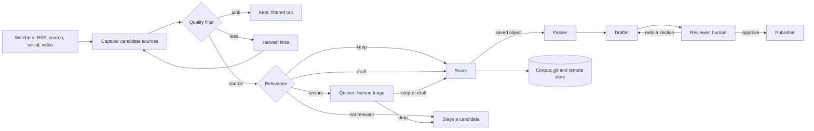

# Self-Generating Content Farm for Content Marketing

> [!NOTE] Name collision
> `content-farm/` is already the name of our Obsidian plugin family (perplexed, cite-wide, metafetch and others). This spec is about a *system* that farms content. It would likely reuse those plugins' logic, but it isn't that repo.

## Why care?

Content marketing works when it is timely, specific and credible, and it dies when it depends on someone remembering to write. We already prove the first half by hand. `lost-in-public/keeping-up/` holds 107 posts, every one of them written by a person or an agent session, none of them generated by a running system.

We also already know what the generated thing should look like. On 2026-11-18 an agent, unprompted, read six months of Claude and ChatGPT releases and sorted which ones matter to VCs and which to skip ([Agent Guesswork on Timeline Relevance for VCs](../../astro-knots/sites/fullstack-vc/context-v/narratives/Agent-Guesswork-on-Timeline-Relevance-for-VCs.md)). That is content marketing for the Agentic VC Dojo, produced as a side effect. This spec is about making it the main effect, and making it run without us.

## How we're building it

As usual with Lossless Group projects, this is an open-source utility built in public, on the way to solving a problem we and our clients (startups and VCs) already have. We need it for lossless.group and the Agentic VC Dojo first. Clients who want the same thing can take it, run it, and change it. The specs, changelog and code are public, and the content is the client's.

## An example in the market: The Prompting Company

[The Prompting Company](https://promptingcompany.com/) (YC-backed, sometimes called "The Prompt Company") is a content farm with a commercial model. It finds the questions people ask AI tools about a product category, writes structured answers, and publishes thousands of AI-optimized pages so that ChatGPT and other assistants cite its customers, even where they don't rank in traditional search. It routes AI agents to those pages, and charges by the number of prompts tracked and pages hosted. Its customers are mostly fintech, developer tools and enterprise SaaS. ([TechCrunch, 2025-10-30](https://techcrunch.com/2025/10/30/the-prompting-company-snags-6-5m-to-help-products-get-mentioned-in-chatgpt-and-other-ai-apps/), on its $6.5M raise.)

What it shows us:

- **The reader is changing.** People increasingly ask AI to find products, and agents will soon browse and buy for them. Content now has to work for agents as well as people. This is generative engine optimization (GEO). See also [[Scrunch]], and our `open-graph-share-seo-geo` skill, which covers `llms.txt`.
- **Volume only works with a pipeline.** Thousands of pages can't be written by hand. They need exactly the watch, draft, review and publish loop this spec describes.
- **Where we differ:** we keep a human approval step on every piece, require a captured source behind every claim, and publish the tool as open source rather than renting it out per page.

## What it does

1. **Watches** sources chosen per audience: product changelogs and releases, blogs and RSS, papers, filings, a firm's own portfolio news.
2. **Filters** out junk, slop and SEO spam, and follows leads to the primary source.
3. **Decides relevance** for a named audience (VCs, philanthropic fundraisers, developers), and routes each item: to a human when unsure, to be saved when it matters, and on to drafting when it's worth writing about now.
4. **Saves** what matters, as markdown in git and/or a remote store, so it's kept whether or not anything is written about it yet.
5. **Drafts** content in a house voice, citing only saved sources.
6. **Reviews:** a human approves, edits, rejects, or asks for one section to be redone.
7. **Publishes** approved drafts to the sites and channels that audience reads, and logs what shipped.

The system is "self-generating" in that steps 1–5 run on a schedule with no one asking. It is not self-publishing. Step 6 is permanent.

## Principles

- **Retrieval and writing are separate stages.** Sources are found, captured and judged before any prose exists, and the writer only sees approved sources. (From memopop: [Separating Retrieval from Generation in Agent Pipelines](../../ai-labs/memopop-ai/context-v/explorations/Separating-Retrieval-from-Generation-in-Agent-Pipelines.md).)
- **Sources persist across runs.** A source a human rejected stays rejected, and a good one doesn't have to be found again. ([Curating Only Valid Sources Across Runs](../../ai-labs/memopop-ai/context-v/explorations/Curating-only-valid-Sources-across-Runs.md).)
- **Revise, don't regenerate.** Feedback on one section reworks that section, not the piece. (perplexed: [Section Refresh and Source Curation](../../content-farm/plugin-modules/perplexed/context-v/plans/2026-09-10_Section-Refresh-and-Source-Curation.md).)
- **Specify by quality bar, not implementation.** What a good output must satisfy is written down first, ranked. (The shape that shipped in augment-it: [Funder Content Corpus Workflow](../../ai-labs/augment-it/context-v/specs/Funder-Content-Corpus-Workflow.md).)
- **Everything is markdown in git.** Drafts, sources, decisions and the publish log are files, so agents work with them fluently and every change has history. The people approving never need to see that. See [[Zero-Complexity-Content-Repositories-for-Collaboration-on-Web-Content]].
- **Backdate to the event.** A post about a release is dated to the release, not to when it was written.
- **Sources and our own content never mix.** The corpus keeps both, but always marks which is which, and the Drafter only ever cites sources. See "Sources and our own content" below.

## Architecture



| Stage | Prior art to reuse |
|---|---|
| Watch config and watchers | [[Self-Updating-Product-Announcement-Watcher]]: sidecar `.watch.yml`, GitHub/RSS/changelog watchers, state file, dedupe. Never built. This spec makes it the first stage of something larger. |
| Source store | cite-wide's [Maximize Data Collection on Canonical Sources](../../content-farm/plugin-modules/cite-wide/context-v/blueprints/Maximize-Data-Collection-on-Cannonical-Sources.md): which source fields are deterministic, hybrid or AI-filled. `crawl-fetch-ingest` skill for capture. |
| Quality filter | memopop's source curation across runs, the `humanizer` skill's catalogue of slop patterns, corpora-builder's `machine_verdict`. Described below. |
| Relevance | The Agent Guesswork narrative above as the first worked example. Audience profiles are new. |
| Queuer | corpora-builder's [Source Curation Gate](../../ai-labs/context-v/blueprints/Source-Curation-Gate.md) and augment-it's [Corpus Inbox, Capture and Triage](../../ai-labs/augment-it/context-v/specs/Corpus-Inbox-Capture-and-Triage.md). |
| Saver | corpora-builder's [Source File Model](../../ai-labs/corpora-builder/context-v/specs/Source-File-Model.md), [Capture, Link-First](../../ai-labs/corpora-builder/context-v/specs/Capture-Link-First.md) and [Storage Seam](../../ai-labs/corpora-builder/context-v/specs/Storage-Seam.md). The `surrealdb-canonical-layer` and `cloudflare-artifacts-interface` skills. |
| Passer | New. |
| Drafter | perplexed's template-per-heading generation and section refresh. LFM for output. The `humanizer` skill. |
| Reviewer | corpora-builder's [Corpus Change Feed](../../ai-labs/corpora-builder/context-v/specs/Corpus-Change-Feed.md) (Signed-Off): a change record any engine can emit, rendered for someone who will never read a diff. |
| Publisher | Existing Astro Knots sites read content collections from git. Changelog and keeping-up conventions already exist. |

## Watchers: kinds and clusters

There won't be one watcher. There will be different **kinds** of watchers, each watching a **cluster** of content, and each combining RSS and search.

### Clusters

A cluster is a named set of things in our library that belong together, plus what to watch for them. Examples:

- A `tooling/` category, like Code Generators or Data Augmenters
- A concept area in `concepts/` or `vocabulary/`, like Context Engineering
- An open ended question, like "What are the best practices for building AI agents?"
- A client's sector, like philanthropic fundraising or K-12 edtech
- A VC firm's thesis, which is also how the [[Self-Generating-Deal-Scout-for-VC-Opportunity-Scans|Deal Scout]] uses it

A cluster carries its entities (tools, companies, people), its vocabulary, the feeds that cover it, the searches that cover the rest, and the corpus its findings are filed into.

### Kinds of watchers

| Kind | Watches for | Example cluster |
|---|---|---|
| **Announcement** | Releases, launches and changelog entries from known products | Code Generators in `tooling/` (the original [[Self-Updating-Product-Announcement-Watcher]]) |
| **Entity** | Anything new about a named company, person or organization | A client's competitors, a portfolio |
| **Topic** | New writing on a theme, from sources that pass the quality filter below | Agent harnesses, GEO |
| **Source** | Everything from a publication, author or account we trust | A newsletter, a researcher, a podcast, an account on X, Bluesky or LinkedIn |
| **Question** | What people ask AI tools about a category, and whether our answers show up | A startup client's category (GEO) |
| **Opportunity** | Companies that fit a thesis | A VC firm's thesis (the Deal Scout) |

Each kind has its own default sources, schedule and relevance test. A cluster can have several kinds watching it.

### Combined RSS, search and social

Each watcher draws on three kinds of input:

- **RSS first**, for every source that publishes a feed. It's free, polite and close to real time. See [[RSS-Monitor-Utility-for-the-Always-On-Agents]].
- **Search for the rest**, on a schedule, with queries built from the cluster's entities and vocabulary. It runs through the tool library's `search` capability, so the provider can be SearXNG, Tavily or Exa.
- **Social platforms** for the people and companies who announce things there first. See below.
- **All of it files into the same corpus inbox**, deduped by normalized URL. An item found twice is one source.

This is also how the system maintains itself. When search keeps finding good items on a site, the watcher looks for that site's feed and proposes subscribing. Over time more of a cluster is covered by free feeds and less by paid search.

```yaml
# clusters/code-generators.cluster.yml (sketch)
cluster: code-generators
from: tooling/AI-Toolkit/Generative AI/Code Generators/
corpus: keeping-up/code-generators
watchers:
  - kind: announcement
    feeds: discover        # find feeds for every tool in the folder
    search:
      every: daily
      queries: ["{tool} release", "{tool} changelog"]
  - kind: topic
    search:
      every: weekly
      queries: ["agentic coding harness", "AI code review"]
relevance: developers
```

### Social platforms: X, Bluesky and LinkedIn

A lot of announcements, and most early talk about them, happen on social platforms before (or instead of) a blog post. The original watcher spec put social monitoring out of scope for its first phase. Here it's an input from the start, but the three platforms are very different to reach:

| Platform | How to read it | Notes |
|---|---|---|
| **Bluesky** | Open by design. Public profiles have RSS feeds, and the AT Protocol firehose and custom feeds give the rest. | The easiest of the three. It can go through the RSS Monitor like any other feed. |
| **X** | The official API, which is paid and rate-limited, or a third-party data provider. | Watch a short list of accounts and searches, not the firehose. Cost decides how much. |
| **LinkedIn** | No general API for reading posts. Only third-party data providers, within their terms. | Worth it for company pages and a few people, if a provider covers them. Otherwise leave it to a human. |

Social posts are short and mostly point somewhere else. So a post is usually a lead, not a source (see "Three outcomes" in the quality filter below). The watcher follows its link and files the page it points to, with the post kept as provenance ("first seen on Bluesky, 2026-11-20").

The same platforms are also where approved pieces get published, which belongs to the Publisher stage.

### YouTube and other spoken sources

A lot of the best material in our fields is spoken: talks, founder interviews , launch videos, podcasts. It gets special handling, built on **Stenographer** (`content-farm/plugin-modules/stenographer`, [GitHub](https://github.com/lossless-group/stenographer)), which we made for exactly this. It turns a YouTube, TikTok or podcast link into a note with full frontmatter (that maps to industry-standard metadata like title, description, publish date, duration, etc as well as Academic, MLA, APA, Chicago, etc citation styles) and a timestamped, speaker-aware transcript.

**Watch channels and playlists.** Every YouTube channel and playlist has a free RSS feed (`youtube.com/feeds/videos.xml?channel_id=…` or `?playlist_id=…`), so watching goes through the [[RSS-Monitor-Utility-for-the-Always-On-Agents|RSS Monitor]] at no cost. The feed only lists recent videos, so subscribing to a channel or playlist for the first time backfills it through the YouTube Data API. Playlists are often the better unit to watch: a conference's talks, a show's season, a curator's picks. Stenographer's own roadmap already lists "Playlists and channels".

**Transcripts are the source material.** A video becomes a source the same way a web page does, through capture and the quality filter. Stenographer tries the platform's own captions first, the cheapest option, and runs fresh AI transcription only when there are none. Supadata covers platform links, and AssemblyAI adds speaker labels for audio. Stenographer's [Local Transcription Engine](../../content-farm/plugin-modules/stenographer/context-v/specs/Local-Transcription-Engine.md) spec adds a self-hosted engine for anything private. Following corpora-builder's link-first rule, a new video is first filed with metadata only, and only videos that pass relevance get transcribed.

**Keep every piece of citation data.** A claim from a video has to be checkable, down to the second. We keep:

- The video URL and ID, channel name and ID, and the playlist it came from
- Title, publish date, duration and thumbnail
- Speakers and guests, as they appear in the transcript and the description
- Chapters, if the uploader set them
- Links in the description. They're leads (see the quality filter): the paper, the product or the post the video is about.
- The transcript engine, mode and date
- Timestamps on every transcript segment, so a quote cites the exact moment (`?t=1234`)

The transcript is written as an LFM `:::transcript` block, so the same file reads as plain markdown in Obsidian. Stenographer's README says the block becomes a timestamp-linked player on an Astro Knots site, but as of 2026-11-22 we don't believe that's implemented: we can't find any `:::transcript` handling in LFM (`lfm/` or `astro-knots/packages/lfm`) or a transcript component on any site. The work is specified in LFM's [Transcript Directive spec](../../lfm/context-v/specs/Maintain-Transcript-Blocks-and-Dialog-Embeds.md). Transcripts already live in `sources/Transcripts/`.

**The same lead logic applies.** A reaction video, or a channel that summarizes someone else's talk, is a lead to the original talk. Podcasts follow the same pattern, since their feeds already carry the audio as an enclosure.

## Quality filter: junk, slop and SEO spam

Search, and to a lesser extent feeds and social, return a lot of content that isn't worth anything: SEO spam, affiliate listicles, sites that rewrite other sites, and generated slop. If it reaches the drafter it becomes our claims. So every item passes a quality filter after capture and before relevance.

It looks for:

- **Where the claim comes from.** A primary source (the company's own blog, docs, release notes, a paper, a filing) beats a page that rewrites one. A rewrite gets traced back to its original, and the original is filed instead. That includes news: an outlet whose story quotes Reuters or AP without reporting of its own is a pointer to Reuters or AP, so we go to the wire story.
- **SEO-spam patterns.** Keyword-stuffed titles, dense affiliate links, no author, no date, a site that publishes on every topic at once.
- **Slop patterns.** Generic, padded, hedge-everything prose with no specifics, the same tells our `humanizer` skill removes from our own writing.
- **Duplicates and near-duplicates.** The same text across many domains is syndication or a content farm.
- **The domain's history.** Every human rejection teaches a per-domain reputation (memopop's [Curating Only Valid Sources Across Runs](../../ai-labs/memopop-ai/context-v/explorations/Curating-only-valid-Sources-across-Runs.md)), so a domain rejected often enough stops getting through. Approved domains get through more easily.

### Three outcomes, not two

Plenty of content is borderline. A listicle ("27 AI Coding Tools to Try") is rarely a primary source, and it can be padded or affiliate-driven. But a good one is a useful launch point: it names tools and companies we haven't heard of and links to their sites. Throwing it away loses that. So the filter has three outcomes:

| Outcome | What happens | Typical items |
|---|---|---|
| **Source** | Filed as a candidate source, eligible to be cited | Release notes, docs, company blogs, papers, filings, original reporting (the wire service, not the outlet quoting it) |
| **Lead** | Not cited. Its outbound links are harvested, and the pages they point to go back through capture and the filter. The lead is kept as provenance ("found via ...") | Listicles, roundups, newsletters, aggregators, "awesome" lists, social posts, news stories that only quote another outlet's reporting |
| **Junk** | Kept out of relevance and drafting | SEO spam, scraped rewrites, slop with no outbound links worth following |

A lead's quality can still be judged: a listicle whose links keep turning up good primary sources earns its domain a better reputation as a place to look, even though it's never cited. When a lead quotes rather than links ("according to Reuters"), the filter searches for the original story and files that. A lead is also how new entities get discovered: a tool on a good list that isn't in `tooling/` yet becomes a suggestion for the library.

The filter writes a `machine_verdict` with its reasons (`lead: roundup, 14 outbound links, 3 new to tooling/` or `junk: scraped copy of a vendor blog`), never a `verdict`. Following corpora-builder's rule, only a person decides. Junk is kept out of the relevance and drafting stages but stays in the corpus, so a human can spot-check what got filtered and correct it. Those corrections are what make the filter better.

It's a tool in the tool library like any other, with a manifest, health checks and fallbacks, and it's used by the Deal Scout too.

The filter applies to our own output as well. This spec is literally a content farm, and our drafts have to pass the same test before they reach a human: specific, sourced, and not slop.

## From relevance to publishing: the decision tree

After the quality filter, every item that's a real source meets the relevance judge. From there, five roles carry it the rest of the way:

```text
Relevance ──> Queuer, Saver, Passer ──> Drafter ──> Reviewer, Publisher
```

Each role is small, does one thing, and hands the next one a reference rather than a copy. That's what lets each be replaced, run on its own schedule, or done by a person instead of an agent.

### Relevance

Judges a source against the cluster it came from and the audience it serves, and gives one of four verdicts, with reasons:

| Verdict | Goes to | Meaning |
|---|---|---|
| **Draft** | Saver, then Passer | Matters, and is worth writing about now |
| **Keep** | Saver | Matters, worth keeping for later. Not every saved source becomes a post: building the corpus is a goal in itself |
| **Unsure** | Queuer | The judge can't tell. A person decides |
| **Not relevant** | Nowhere | Stays a candidate in the inbox, so a human can still find it |

Like the quality filter, it writes `machine_verdict`, never `verdict`.

### Queuer

Puts items on the line for human-in-the-loop triage. Each item shows its title, source, the filter's outcome, and why the relevance judge was unsure. A person picks one of three actions: **keep** (to the Saver), **draft** (to the Saver, then the Passer), or **drop** (the person's `verdict`, which the next run respects).

- The line is a page anyone can use: the Corpus Change Feed, a review page, or a folder in an Obsidian vault. See [[Zero-Complexity-Content-Repositories-for-Collaboration-on-Web-Content]].
- It never blocks the pipeline. Items wait while everything else moves.
- Every decision is training data for relevance, the same way rejections train the quality filter's domain reputation.

### Saver

Knows the item matters, and knows how and where to save it. The cluster's config says where:

- **Markdown in a git repo**, almost always. One source file per item with full frontmatter and provenance, in corpora-builder's source file format, or in `sources/` here.
- **And/or a remote store:** SurrealDB as a canonical layer for records and their relations (which posts cite which sources, which companies appear in which), Cloudflare R2 for bodies and binaries through corpora-builder's `CorpusStore`, D1 or Durable Objects for state, or Cloudflare Artifacts for a git repo per collaborator.

```yaml
# in a cluster config (sketch)
save:
  - kind: git
    repo: lossless-content
    path: sources/keeping-up/code-generators/
  - kind: surrealdb
    table: source
  - kind: r2
    bucket: corpora
```

This is the point where the full text gets fetched, since the item has survived the filter and the relevance judge. Saving is idempotent: an item already saved, matched by normalized URL, returns the existing record rather than a second copy.

The Saver returns a **saved object**: the item's IDs (`site_uuid`, `hex_code`), its location in each store (path, record ID, object key), its source URL, title, status and `content_pulled`.

### Passer

Takes the saved object the Saver returns and passes it to the Drafter, along with what the Drafter needs to know: the audience, the cluster, the template, and other saved objects on the same subject. The Drafter reads from the stores. It never gets a copy that could drift from what was saved.

Only items with a **draft** verdict, from the judge or a person, reach the Passer. Items saved with **keep** stay in the corpus until something asks for them.

### Drafter

Writes the piece in the audience's voice and template, citing only saved objects. It runs the `humanizer` pass and then the quality filter on its own output. The draft is a markdown file with frontmatter listing the saved objects it cites.

### Reviewer

A person, every time. They approve, edit, reject, or ask for one section to be redone (which goes back to the Drafter, not to the start). The review surface is the change feed: what's new, what it cites, and one action to approve.

### Publisher

After approval only: commits the piece to the site's content collection, dated to the event it covers, posts to the audience's channels, and writes a publish log. Each saved source gets a backlink to the pieces that cite it.

### Sources and our own content

Drafts and published pieces are worth keeping in the corpus too: to avoid repeating ourselves, to link back to earlier pieces, and to see what we've covered. But if our own writing is saved next to sources with nothing to tell them apart, the next draft can cite our last draft as if it were evidence. Claims then cite claims, and nothing traces back to a primary source.

So every record in the corpus says which kind it is:

| `corpus_role` | What it is | `state` | Where it lives |
|---|---|---|---|
| `source` | Something someone else published, captured by the Saver | the source file model's own `status` (`candidate`, `promoted`, ...) | Source folders, e.g. `sources/` |
| `own` | Something we wrote: a draft or a published piece | `draft`, `approved`, `published` or `rejected` | Draft folders, then the site's content collection once published |

The rules:

- **The Drafter cites only `source` records.** It may *link* to our earlier `own` pieces ("we covered the 2.0 launch here"), but never as evidence for a claim.
- **Retrieval asks for a role.** "Find sources on X" and "find what we've written on X" are different queries, and a query without a role gets sources.
- **Our own pages are recognized when watchers find them.** Search and feeds will turn up our published pages and other sites quoting them. Anything on our own domains is matched to its `own` record, never captured as a new source. A third-party page that only restates our piece is a lead back to it, by the same rule as any rewrite.
- **Own records keep their citations.** A draft's frontmatter lists the IDs of the source records it cites, and those sources get backlinks when it publishes. That way every claim in a published piece can be traced to a primary source in two steps or fewer.

The field is `corpus_role` and not `origin`, because one of the three source-file schemas corpora-builder is reconciling already uses `origin` for search provenance ([Source File Schema Reconciliation](../../ai-labs/corpora-builder/context-v/blueprints/Source-File-Schema-Reconciliation.md)). Adding `corpus_role` there is a proposal for corpora-builder, not something this spec can decide alone.

## Tools: a polyglot library, set up one common way

Every stage above calls tools: search, scrape, crawl, extract, feeds, brand assets, CRM. No one provider is right for all of them, providers change their APIs and prices, and the agents calling them run in different languages and harnesses. A system that's meant to run itself needs one common way to set a tool up, so that it can add, check and repair tools without us.

### What the agent-harnesses study tells us

The [agent-harnesses study](../../ai-labs/studies/agent-harnesses/README.md) asked how harnesses decide which tools are in scope. Its [inquiry](../../ai-labs/studies/agent-harnesses/context-v/inquiry/Targeted-Questions-for-Cross-Product-Shell.md) found two patterns worth copying:

- **One interface for every tool.** In goose, every extension speaks MCP, including built-in tools that never start a separate process. opencode merges built-ins, plugins and MCP servers into one registry and filters it per agent with pattern rules.
- **Visible is not the same as allowed.** goose keeps "can the agent see this tool" (extension config) apart from "can it fire without asking" (`AlwaysAllow` / `AskBefore` / `NeverAllow`). For us: search can always fire, publishing always asks.

[Tome](../../ai-labs/studies/agent-harnesses/context-v/profiles/Profile__Tome.md) shows the same idea one layer up: one catalog, written into each harness's own config. The study lists self-evolving tools as its thinnest area. Every harness it pinned loads tools statically, and only the unpinned candidate youtu-agent has meta-agents that generate tools. This spec has to do new work here.

### The setup contract

A tool is a **manifest** plus an **adapter**:

- The **manifest** is a small declarative file: the capabilities it provides (`search`, `scrape`, `crawl`, `extract`, `feed`, `brand`), its provider, cost and rate limits, its permission tier, where its credentials come from, and a **health check** (a canned call and the shape of a good answer).
- The **adapter** exposes those capabilities over MCP. It can be written in TypeScript, Python or Rust, run in-process or remotely, and the callers never know which.
- **Credentials stay server-side.** Callers get capabilities, not keys ([Secrets for Collaborators Who Will Never Open a Terminal](../../ai-labs/context-v/explorations/Secrets-for-Collaborators-Who-Will-Never-Open-a-Terminal.md)).
- **Agents ask for a capability, not a provider.** "Search" resolves to the best healthy provider for the job, with the rest as fallbacks.

That one contract is what makes the three "self" properties possible:

| Property | What it means here |
|---|---|
| **Self-generating** | Given a provider's docs or OpenAPI spec, an agent drafts a manifest and adapter. It goes through the same review queue as content, and no new tool goes live without a human yes. |
| **Self-maintaining** | Health checks run on a schedule. Cost, latency and failures are logged per call. Dependency bumps run as a loop (see the `dependency-upgrade-loop` skill). |
| **Self-healing** | A failing provider is quarantined and its capability falls back to the next one. An agent drafts a fix to the adapter, and the fix goes to review. |

### Providers

| Capability | Providers | Notes |
|---|---|---|
| Search | [[Searxng\|SearXNG]], [[Tavily AI\|Tavily]], [[Exa.ai\|Exa]], Brave Search API, [[SerpAPI]] | SearXNG is free and self-hostable, a metasearch over up to 249 engines, so it's the default. Tavily is built for agents. Exa does meaning-based search and "find similar", which suits the Deal Scout. Brave has its own index. |
| Scrape and crawl | [[Firecrawl]], [[Context.dev]], [[Jina.ai\|Jina Reader]], Crawl4AI | Firecrawl and Context.dev both turn URLs into markdown and extract structured data for agents. Jina Reader is already used in the watcher spec. Crawl4AI is open source and self-hostable, so SearXNG plus Crawl4AI is a fully free stack. |
| Hard pages | [[Browserbase]], [[Apify]], [[Bright Data]] | For JavaScript-heavy pages, logins and anti-bot measures. Use these only when cheaper providers fail. |
| Structured records | Firecrawl's Alexandria providers | Typed, sourced records for companies, people, filings and jobs. Most useful for the Deal Scout. |
| Feeds and page changes | [[RSS-Monitor-Utility-for-the-Always-On-Agents]], changedetection.io | Feeds where sites publish them, change detection where they don't. |
| Social | Bluesky (AT Protocol, RSS), X API, third-party data providers for X and LinkedIn | See "Social platforms" above. |
| Video and audio | Stenographer (Supadata, AssemblyAI, a local Whisper-compatible engine), YouTube channel and playlist feeds, YouTube Data API | See "YouTube and other spoken sources" above. |
| Brand assets | Brandfetch | Logos and colors for posts and deal briefs. |

Answering "any others very important?": **Exa**, **Jina Reader** and **Crawl4AI** belong on the first list. Exa is the strongest search for finding companies like a known one. Jina Reader is cheap and already in our specs. Crawl4AI gives SearXNG a free, self-hosted partner. **Brave Search API** is the main independent index besides Google and Bing. **changedetection.io** covers pages with no feed.

## Where it runs: scheduled agents that trigger agents, off the laptop

Everything above has to run with the laptop closed: on a clock, with one agent's output starting the next agent's work. We've reasoned about this several times. What's changed is that we now have one piece actually running (kay-os's mail sync on Cloudflare), a blueprint for cloud computers per agent (boxes.dev), and a new option for sandboxes (E2B).

### What we've already worked out

- **A Cloudflare Worker on a cron, with a Durable Object per job, works.** kay-os's `kay-os-mail-sync` wakes every five minutes, and each mail account gets its own Durable Object: a small worker with its own SQLite database and a timer, which never runs twice at once. ([Mail Archive in Cloudflare R2](../../ai-labs/kay-os/context-v/blueprints/Mail-Archive-in-Cloudflare-R2.md), [Email Repository and Agent Harness](../../ai-labs/kay-os/context-v/explorations/Email-Repository-and-Agent-Harness.md), which chose Cloudflare over a Hetzner VPS on 2026-11-06 and keeps Hetzner as the fallback.)
- **A coding agent can have its own cloud computer.** boxes.dev gives Claude Code and Codex a devbox with the project already running, so work continues after the laptop closes. ([Run an Astro Knots Site on boxes.dev](../../astro-knots/context-v/blueprints/Run-an-Astro-Knots-Site-on-Boxes-dev.md), written before its first run.)
- **A hosted conversational agent is reachable, but not trusted with accounts.** Hermes on Agent37 answers from the phone. It shouldn't hold email, CRM or calendar keys yet, so kay-os would sit between it and the accounts. ([Customizing Hermes Agent through API](../../ai-labs/kay-os/context-v/explorations/Customizing-Hermes-Agent-through-API.md), [A Gateway Between Agents and My Accounts](../../ai-labs/kay-os/context-v/explorations/A-Gateway-Between-Agents-and-My-Accounts.md), and self-host-stack's [Hermes colocation](../../self-host-stack/context-v/explorations/Hermes-Agent-Colocation-and-Hackability.md) and [multi-user](../../self-host-stack/context-v/explorations/Hermes-Agent-Multi-User-Team-Access.md) explorations.)
- **Agents get capabilities, not keys.** ([Secrets for Collaborators Who Will Never Open a Terminal](../../ai-labs/context-v/explorations/Secrets-for-Collaborators-Who-Will-Never-Open-a-Terminal.md))
- **Unattended work needs written limits.** corpora-builder's [Autonomy Gates](../../ai-labs/corpora-builder/context-v/contracts/Autonomy-Gates.md) list what an agent may do alone and where it must stop.
- **The record can be the shared memory.** Cloudflare Artifacts is plain git that any agent with a token can pull and push, so it can hold the record that agents hand to each other. ([Using Cloudflare Artifacts as Knowledge Graph](../../ai-labs/kay-os/context-v/explorations/Using-Cloudflare-Artifacts-as-Knowledge-Graph.md))
- **A fleet can be run from a work queue.** Symphony turns an issue tracker into the queue for a fleet of coding agents, with a poll, reconcile and dispatch loop. ([Symphony profile](../../ai-labs/studies/open-specs-and-standards/context-v/profiles/Profile__Symphony.md))

### Three layers

Putting those together, the system runs in three layers:

| Layer | Job | Runs on | Cost when idle |
|---|---|---|---|
| **Clock and queue** | Wake on schedule, poll feeds and searches, keep state, hand work on, retry | Cloudflare Workers with Cron Triggers, a Durable Object per cluster, Queues or Workflows for fan-out | Near zero |
| **Agent runs** | Anything that needs a real computer: a shell, git, a browser, a long model loop, or running code we didn't write | [Cloudflare Sandboxes](https://developers.cloudflare.com/sandbox/) first; [[E2B]] where we need its pause and fork; a [boxes.dev](https://boxes.dev) devbox for coding agents | Sandboxes stop between runs; boxes can sleep |
| **Records** | What agents hand each other: sources, saved objects, drafts, verdicts | Git (GitHub or Cloudflare Artifacts) as the record, SQLite (D1 or Durable Object storage) as the index, R2 for bodies and files | Storage only |

**Cloudflare Sandboxes** is the first choice for the agent-run layer, because it lives on the same platform as the clock. A Durable Object in a Worker starts a sandbox from an image and runs commands in it. A sandbox is either a Container (a Linux microVM with its own kernel and network, the E2B-like option) or a Dynamic Worker (lighter: untrusted code loaded as its own isolated Worker). It can run commands, work with files, keep processes running, preview apps, and run coding agents. A workspace can be kept between instances, an R2 bucket mounted, and files snapshotted. As of 2026-11-22, the container scheduling it depends on is in public beta.

[[E2B]] is the alternative. Each agent gets an isolated Linux VM, started from code in JavaScript, TypeScript or Python. Pausing saves the VM's disk and memory, and a paused sandbox is kept until it's killed, so an agent can sleep between runs and pick up where it stopped. Sandboxes can also be forked, and E2B runs in its own cloud or in your AWS, GCP or Azure account. It has no scheduler of its own, which is the clock layer's job. It's also the natural place for the self-generating tool library to try out an adapter an agent just wrote, since that's code no human has read yet.

### Records: git for the record, SQLite for the index

Git holds the readable record: markdown with frontmatter and history, editable by people and agents. Next to it, a SQLite database holds what has to be fast to write and query:

- One row per saved object, with its IDs, `corpus_role`, `status` or `state`, and verdicts
- A unique index on `normalized_url`, so saving twice returns the existing row
- FTS5 full-text search over saved text
- The queue the Queuer, Passer and Publisher work from

SQLite is a good fit: each save is a transaction, WAL mode lets reads continue during writes, JSON columns hold frontmatter-style metadata, and its one-writer-at-a-time limit doesn't matter at a few hundred saves a day. The index is rebuilt from git if it's ever lost. That's the split the kay-os [Artifacts exploration](../../ai-labs/kay-os/context-v/explorations/Using-Cloudflare-Artifacts-as-Knowledge-Graph.md) and corpora-builder ("files are the truth; the database indexes them") already reached.

Cloudflare's managed databases are SQLite:

| Option | What it is | Limits (2026-11-22) | Use for |
|---|---|---|---|
| **D1** | SQLite as a service | 10 GB per database on the paid plan (500 MB free), up to 1,000,000 databases per account, 2 MB per row or value | The index for a cluster or a client |
| **Durable Object storage** | A private SQLite database inside each Durable Object | 10 GB each | State for one watcher or one account, as kay-os does |
| **Hyperdrive** | Pooled, cached connections from Workers to your own Postgres or MySQL hosted elsewhere | Postgres and MySQL only | If we outgrow SQLite |

Bodies over 2 MB and binaries go to R2. A database of our own, such as SurrealDB for relations between records, runs elsewhere and is called through its own API, since Hyperdrive only speaks Postgres and MySQL.

### Agents trigger agents through the record, not directly

No agent calls another agent. An agent finishes by writing its result to the record (a saved object, a draft, a verdict) and emitting an event. The clock layer sees the event and starts the next role. This is the decision tree's rule ("hand the next one a reference, not a copy") applied to infrastructure:

- Every hand-off is a file or a row, so it can be read, retried and audited.
- A failed agent leaves the record where it was, and the next tick tries again.
- Any role can be swapped (a person instead of an agent, E2B instead of boxes.dev) without the others noticing.

The A2A protocol ([profile](../../ai-labs/studies/open-specs-and-standards/context-v/profiles/Profile__Agent-2-Agent.md)) is the standard to check if direct agent-to-agent calls are ever needed.

### Where each role runs

| Role | Layer | Why |
|---|---|---|
| Watchers, RSS Monitor | Clock and queue | Cheap, frequent, no model needed |
| Capture, quality filter, relevance | Clock and queue, calling a model API | Short, stateless calls |
| Queuer | A page over the records | People triage it |
| Saver | Clock and queue, writing to the records | Plain writes |
| Passer | A queue message | It's only a reference |
| Drafter | Agent run (E2B) | Long loops, tools, a filesystem |
| Tool repair and new tools | Agent run (E2B or boxes.dev) | Runs code no one has reviewed |
| Reviewer | A person | Always |
| Publisher | Clock and queue, committing to git | The site deploys from the commit |

### Open questions

- Is Cloudflare Sandboxes' beta enough to build on, and do its snapshots keep memory as well as files, as E2B's pause does? If not, which roles move to E2B, and does the Worker call E2B's API over HTTP?
- Where does git live for agents: GitHub with a bot account, or Cloudflare Artifacts with a repo per agent?
- Are Claude Code's scheduled cloud agents (routines), Railway's cloud agent tasks, [[Modal]] or [[Fly.io]] better for any of these roles than E2B or boxes.dev?
- What does a month of this cost for one cluster, and what's the alert when it stops?

## Audiences, first

Each audience is a small config: who they are, the sources they care about, what counts as relevant, the voice, and where approved pieces go.

| Audience | Sources | Output | Lands on |
|---|---|---|---|
| Developers and AI builders | The 1,400+ tools in `tooling/` | keeping-up posts | lossless.group |
| VCs (Agentic VC Dojo) | Model and agent-tool releases | "What this means for your firm" notes | fullstack-vc.com |
| A client's donors or LPs | Sector news, the client's own outcomes | Updates in the client's voice | The client's hub site |
| AI assistants and agents (GEO) | The questions people ask AI about a client's category | Structured answer pages, `llms.txt` | A startup client's site |

The first row is the watcher spec's original scope, so it's the natural pilot.

## Quality bar (ranked)

1. **No unsourced claims.** Every factual sentence traces to a captured source a human can open.
2. **Nothing publishes without a human yes.**
3. **Relevant, or silent.** A week with nothing worth saying produces nothing.
4. **Dated to the event**, linked to the tool or entity file it's about.
5. **Sounds like us**, not like a generated summary.
6. **Cheap enough to run every day** for every audience.

## Phases

1. **Pilot one audience by hand-running the pipeline.** Developers and keeping-up posts: watch config for 50 tools, drafts into a review folder, a human approves in Obsidian or on GitHub.
2. **Schedule it.** Watchers and drafting on a cron, the change feed as the review surface.
3. **Second audience.** VCs on fullstack-vc.com, which forces audience config to be real rather than hard-coded.
4. **Client audiences.** Needs [[Zero-Complexity-Content-Repositories-for-Collaboration-on-Web-Content]] so a client can approve without our tools.

### Future Versions - Ideas

- Take an action: Generate a tweet or LinkedIn post based on the content
- Take an action: Generate a video script based on the content (Reaction Videos, Debunk Videos, etc.)
- Take an action: Newsjacking - Generate content based on current events and trends and publish before hype cycle dies down.
- SEO Gaming: Optimize content for search engines and social media platforms, including using additional web properties to boost visibility.

## Shared with the Deal Scout

[[Self-Generating-Deal-Scout-for-VC-Opportunity-Scans]] is the same machine aimed at companies instead of announcements: watch, capture, judge fit, draft, review. The watcher, source store and review queue should be one implementation serving both. Only the relevance judge and the output templates differ.

## Open questions

- Where does it run: a Cloudflare Worker on a cron (as kay-os does for mail), GitHub Actions, or a local agent loop?
- Is the review queue a web page, a pull request, or a folder in an Obsidian vault? Probably all three, rendered from the same change record.
- How is "sounds like us" specified: a voice guide per audience, examples, a `humanizer` pass?
   - Follow content outlines for each content type, such as found in Perplexed, MemoPop Orchestrator.
- What gets measured after publishing, and does it feed back into relevance?
- Should `corpus_role` become part of corpora-builder's source file model, or live only in this system's records?
- Is the tool manifest our own format, or do we adopt goose's extension config or Tome's plugin manifest?
- Does the tool library live in its own repo, so the Content Farm and the Deal Scout (and kay-os) share it?

## Related

- [[Self-Updating-Product-Announcement-Watcher]]
- [[RSS-Monitor-Utility-for-the-Always-On-Agents]]
- `ai-labs/studies/agent-harnesses/`
- [[Self-Generating-Deal-Scout-for-VC-Opportunity-Scans]]
- [[Zero-Complexity-Content-Repositories-for-Collaboration-on-Web-Content]]

# Stacks and Technical Options

## How persistent, proactive agents work

Every guide below, whatever the stack, comes down to the same three parts:

1. **A clock or a trigger.** Something outside the agent wakes it up: a cron schedule, a new email, a webhook, a message on a queue. The agent doesn't sit in a loop waiting. It's started, does one bounded job, and stops.
2. **State outside the model.** The model forgets everything between runs. What it knows lives in files, a database or a log: a plan, a progress file, what it has already seen. Each run starts by reading that state and ends by writing it back.
3. **Durable steps.** Each call to the outside world (the model, a search, a save) is recorded as it finishes. If the run crashes or has to wait days for a human, it picks up from the last finished step instead of starting over. This is what Temporal, Inngest, Cloudflare Workflows and Durable Objects provide.

Our layers map onto these: clock and queue (1), records (2), and agent runs on top of durable steps (3).

## How-to articles and videos

Found 2026-11-23. Articles were skimmed from search results; the videos haven't been watched, so judge them by their first few minutes.

### Start here: what "long-running" means

- [Long-running Agents](https://addyosmani.com/blog/long-running-agents/) (Addy Osmani, also on [O'Reilly Radar](https://www.oreilly.com/radar/long-running-agents/)). The best overview. Separates long reasoning, long execution and persistent identity, names the three walls every long run hits, and ends with "so how do you actually build one today?"
- [Long-horizon agents and durable execution](https://martinfowler.com/articles/durable-execution-agents.html) (Kiran Prakash, on martinfowler.com). Walks one agent through a weeks-long task and every way it can fail. Built on Temporal and **Cloudflare Workflows**, so it's close to our stack.
- [Effective harnesses for long-running agents](https://www.anthropic.com/research/effective-harnesses-for-long-running-agents) (Anthropic). An initializer agent sets up the work, then each later session makes one step of progress and leaves notes for the next. The same idea as our record.
- [Long-Running AI Agents: State, Waiting and Recovery](https://www.querynow.com/ai-agents/orchestration/long-running-agents) (QueryNow). Budgets, kill switches, waiting for a person, and how AWS, Azure and Google each do it.

### On Cloudflare (our first choice)

- [Build your first Durable Agent](https://developers.cloudflare.com/agents/getting-started/quick-start/) (Cloudflare docs). The quick start, ending with the Scheduler: "run the agent on a schedule, such as a plan every morning."
- [Learn Agents SDK](https://labs.cloudflare.dev/agents) (Cloudflare Labs). A step-by-step starter where you ask the agent to schedule, repeat and cancel its own tasks.
- [Cloudflare Agents 101: Deploy your first AI agent](https://www.youtube.com/watch?v=SujrIrj-aZ8) (video).
- [cloudflare/agents](https://github.com/cloudflare/agents) on GitHub. The SDK's source and examples, including one-time, recurring and cron tasks.

### Durable workflows (Temporal, Inngest)

- [Durable Execution: The Key to Harnessing AI Agents in Production](https://www.inngest.com/blog/durable-execution-key-to-harnessing-ai-agents) (Inngest). Why each tool call should be a step that retries, and how human approval becomes a pause.
- [How to Build and Scale Long-Running Enterprise Agents](https://scale.com/blog/agentex-temporal-tutorial) (Scale AI, Agentex with Temporal). The "wake up, act, go back to sleep" pattern, with human-in-the-loop pauses that can last weeks.

### Ambient agents (watching and acting without being asked)

- [Introducing ambient agents](https://www.langchain.com/blog/introducing-ambient-agents) (LangChain). Defines the idea, with an email assistant that runs on a cron job.
- [Building Ambient Agents with LangGraph](https://www.youtube.com/watch?v=1HTXbcj3gWE) (LangChain Academy, video course) and its code, [ambient-agent-101](https://github.com/langchain-ai/ambient-agent-101).
- [Ambient Agents: Always On, Always Working](https://medium.com/@ericbroda/ambient-agents-always-on-always-on-always-working-387238d03e05) (Eric Broda). Why background agents become a distributed-systems problem.

### The simplest version: an agent on a cron job

- [Run on a schedule](https://code.claude.com/docs/en/github-actions#run-on-a-schedule) (Claude Code GitHub Actions docs). A daily Claude Code run from a GitHub Actions cron, no server needed. The quickest way to try the pattern.
- [Put an AI Agent on a Cron Job](https://www.developersdigest.tech/blog/opencode-cron-automation-guide) (Developers Digest). Seven steps from a bare machine to scheduled agents that open PRs, with guardrails.
- [How to Build and Schedule Local AI Assistants for Daily Tasks](https://www.freecodecamp.org/news/how-to-build-and-schedule-local-ai-assistants-for-daily-tasks/) (freeCodeCamp). A folder of agents, a small Python scheduler and cron, running local models.
- [How to Build an AI Agent That Runs While You Sleep](https://www.mindstudio.ai/blog/ai-agent-runs-while-you-sleep-scheduled-automations-claude) (MindStudio). Three ways: Claude Code with cron, Hermes, and a hosted scheduler.
- [Build Your Own AI Butler: A Scheduled Agent That Runs Itself](https://dev.to/aws/build-your-own-ai-butler-a-scheduled-agent-that-runs-itself-3dmk) (AWS on dev.to). An agent defined in a config file and a prompt, deployed to run on a schedule.

### Videos: always-on assistants

- [How to Schedule Your AI Agents with Cron Jobs](https://www.youtube.com/watch?v=__m9SnhJXVM) (Agentuity).
- [How to Build 24/7 Claude Agents](https://www.youtube.com/watch?v=Ovj5f0ajDww).
- [FULL Hermes Agent Tutorial for Beginners](https://www.youtube.com/watch?v=4ftONmdO9yo) (AI Foundations). Hermes is the hosted agent already in our notes.
- [Build Your Own 24/7 AI Agent in 30 Minutes (OpenClaw Tutorial)](https://www.youtube.com/watch?v=Mij78eRAa_k).
- [How to Run an AI Agent 24×7 (Beginner Walkthrough)](https://www.youtube.com/watch?v=E718k6LtDh0).

If you only have an hour: read Addy Osmani's overview, then the martinfowler.com piece, then do Cloudflare's quick start.
