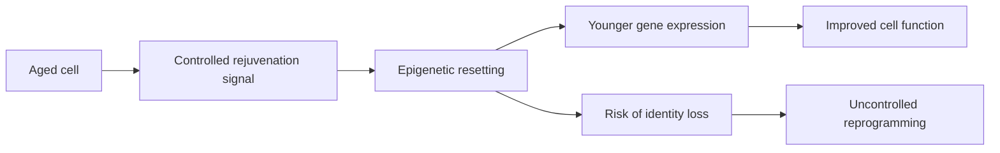

[[concepts/Longevity Tech|Longevity]]

# Defining and Describing Cellular Rejuvenation

 

- _Cellular rejuvenation is the attempt to make aged cells function more like younger cells without necessarily replacing them._
- The concept describes interventions that alter age-associated cellular states, often by resetting epigenetic patterns, improving gene expression, reducing senescence-associated dysfunction, or restoring regenerative capacity. [^80i7rd] [^s0j93z] [^tzhls2]
- The most prominent experimental strategy is **partial cellular reprogramming**: controlled, temporary expression of the Yamanaka factors—OCT4, SOX2, KLF4, and sometimes c-MYC—to reverse selected aspects of cellular aging while avoiding complete conversion into induced pluripotent stem cells. [^nb2xje] [^s0j93z] [^tzhls2]
- Unlike full reprogramming, which erases cellular identity to create an induced pluripotent stem cell, partial reprogramming aims to preserve the cell’s identity while improving its function. [^nb2xje] [^s0j93z]
- Evidence remains strongest in laboratory and animal models; translation to humans requires careful evaluation of delivery, dosing, durability, tissue specificity, and risks such as abnormal growth or loss of cell identity. [^s0j93z] [^13tdo8]

# Uses in Context

- **Aging biology:** Researchers use “cellular rejuvenation” to describe restoring youthful molecular or functional properties to aged cells rather than merely treating individual symptoms. [^80i7rd] [^tzhls2]
- **Epigenetic medicine:** Biotechnology companies invoke the term for platforms that reset age-associated gene-regulation patterns; Life Biosciences describes its approach as restoring older and damaged cells to a “younger and healthier state.” [^13tdo8] [^dfp92t]
- **Regenerative medicine:** The concept is applied to muscle, pancreatic, cardiac, vascular, skin, and nervous-system repair, where reprogramming may improve tissue regeneration after injury. [^s0j93z] [^3zo5gx]
- **[[concepts/Longevity Tech|Longevity Tech]] biotechnology:** Startups frame cellular rejuvenation as a potential route to treating diseases of aging by restoring cell function in particular organs rather than attempting whole-body age reversal. [^13tdo8] [^1qsedv] [^feur5p]
- **Scientific criticism:** Aging researchers also use the term cautiously, noting that “younger” cellular measurements do not automatically establish organismal rejuvenation or health benefit. [^80i7rd]

# History of Use

## Origins

- The modern experimental foundation was established by Shinya Yamanaka and colleagues, who reported in 2006 that four transcription factors could convert adult cells into induced pluripotent stem cells. [^s0j93z]
- The factors—OCT4, SOX2, KLF4, and c-MYC—became known as the Yamanaka factors and demonstrated that differentiated-cell identity could be reset through changes in gene regulation. [^nb2xje] [^s0j93z]
- The specific rejuvenation idea emerged later from efforts to express these factors temporarily or cyclically, seeking age reversal without complete dedifferentiation. [^nb2xje] [^s0j93z]

## Evolution

- **2006:** Full cellular reprogramming showed that adult cell identity could be reset to an embryonic-like pluripotent state. [^s0j93z]
- **2013–2016:** Studies using controlled or cyclic expression of reprogramming factors in mice reported improved regeneration and lifespan-related outcomes while avoiding complete dedifferentiation. [^nb2xje] [^s0j93z]
- **2020s:** The field expanded from animal studies toward tissue-specific therapies and early human translation, including an optic-neuropathy candidate based on controlled OSK expression. [^13tdo8] [^1qsedv]

# Best Real-World Examples

- [Partial reprogramming in aged mice](https://pmc.ncbi.nlm.nih.gov/articles/PMC13692703/) — Cyclic Yamanaka-factor expression was investigated as a way to improve tissue repair while preserving cellular identity. [^nb2xje]
- [Yamanaka-factor studies in progeria and aged mice](https://www.scientificamerican.com/article/this-method-to-reverse-cellular-aging-is-about-to-be-tested-in-humans) — Temporary, repeated factor expression extended lifespan in a progeria model and improved muscle and pancreatic regeneration in older mice. [^s0j93z]
- [Endothelial-cell rejuvenation](http://www.link.springer.com/article/10.1007/s00395-026-01192-7) — A pharmacological cocktail induced temporally restricted OSKM expression and improved senescent endothelial-cell function in laboratory and animal experiments. [^3zo5gx]
- [Life Biosciences ER-100](https://www.lifebiosciences.com/life-biosciences-announces-first-patient-dosed-in-phase-1-trial-of-er-100-for-optic-neuropathies/) — An early clinical candidate uses controlled OCT4, SOX2, and KLF4 expression for optic neuropathies. [^13tdo8]
- [Life Biosciences Epigenetic Restoration platform](https://www.lifebiosciences.com/life-biosciences-secures-80-million-series-d-financing/) — The platform is designed to partially reprogram aged or injured cells through OSK expression. [^1qsedv]
- [NewLimit](https://www.businessinsider.com/billionaires-love-cellular-reprogramming-longevity-it-may-work-2026-10) — The biotechnology startup is pursuing cell reprogramming research, including a proposed liver-cell therapy program. [^feur5p]
- [Retro Biosciences](https://www.businessinsider.com/billionaires-love-cellular-reprogramming-longevity-it-may-work-2026-10) — The company is identified as another startup exploring cellular reprogramming for longevity applications. [^feur5p]

# Case Studies

**Partial reprogramming in mice.** Researchers led work using intermittent expression of Yamanaka factors rather than continuous expression, because sustained exposure can erase cellular identity and create safety concerns. [^nb2xje] [^s0j93z] In progeria mice, cyclic expression extended lifespan, while experiments in normal aged mice improved regeneration in tissues including muscle and pancreas. [^s0j93z] The case established a central principle of cellular rejuvenation: a brief, controlled intervention may recover some youthful functions without requiring total conversion into stem cells. [^nb2xje] [^s0j93z]

**ER-100 and optic neuropathies.** Life Biosciences translated the partial-reprogramming concept into a tissue-specific clinical program targeting optic neuropathies. [^13tdo8] [^1qsedv] ER-100 uses controlled expression of OCT4, SOX2, and KLF4 to reset aspects of the epigenetic state in affected cells, and its Phase 1 study evaluates safety and tolerability in conditions including glaucoma and non-arteritic anterior ischemic optic neuropathy. [^13tdo8] [^1qsedv] The program illustrates how the field is moving from broad claims about age reversal toward localized treatment of defined diseases, while clinical efficacy and long-term safety remain to be established. [^13tdo8]

**Endothelial-cell rejuvenation.** A research study reported that transient, non-genetic activation of Yamanaka factors reduced senescence-associated features and improved endothelial function and angiogenic capacity in laboratory and animal settings. [^3zo5gx] The use of compounds already approved for other indications was presented as a possible way to induce temporary factor expression without directly introducing permanent genetic changes. [^3zo5gx] This example shows the field’s expansion beyond gene delivery toward pharmacological control, but it remains preclinical evidence rather than proof of a validated human rejuvenation therapy. [^3zo5gx]

***

# Sources

[^nb2xje]: 2026, Oct 23. [pmc.ncbi.nlm.nih.gov](https://pmc.ncbi.nlm.nih.gov/). [In Vivo Partial Cell Reprogramming With Yamanaka Factors ...](https://pmc.ncbi.nlm.nih.gov/articles/PMC13692703/). Updated: 2026, Nov 06. Generated: 2026, Nov 06. [Perplexity](https://www.perplexity.ai/) API response.
[^80i7rd]: 2026, Oct 27. [link.springer.com](https://link.springer.com/). [Seven ways not to think carefully about aging - The EMBO Journal](https://link.springer.com/article/10.1038/s44318-026-00946-2). Updated: 2026, Oct 29. Generated: 2026, Nov 06. [Perplexity](https://www.perplexity.ai/) API response.
[^s0j93z]: 2026, Apr 13. [scientificamerican.com](https://www.scientificamerican.com/). [This method to reverse cellular aging is about to be tested in humans](https://www.scientificamerican.com/article/this-method-to-reverse-cellular-aging-is-about-to-be-tested-in-humans). Updated: 2026, Oct 29. Generated: 2026, Nov 06. [Perplexity](https://www.perplexity.ai/) API response.
[^13tdo8]: 2026, Jun 09. [lifebiosciences.com](https://www.lifebiosciences.com/). [Life Biosciences Announces First Patient Dosed in Phase 1 ...](https://www.lifebiosciences.com/life-biosciences-announces-first-patient-dosed-in-phase-1-trial-of-er-100-for-optic-neuropathies/). Updated: 2026, Oct 02. Generated: 2026, Nov 06. [Perplexity](https://www.perplexity.ai/) API response.
[^dfp92t]: 2026, Oct 08. [lifebiosciences.com](https://www.lifebiosciences.com/). [Life Biosciences Announces First-in-Human Data from Ongoing ...](https://www.lifebiosciences.com/life-biosciences-announces-first-in-human-data-from-ongoing-phase-1-trial-evaluating-er-100-in-optic-neuropathies/). Generated: 2026, Nov 06. [Perplexity](https://www.perplexity.ai/) API response.
[6]: 2026, Oct 01. [lifebiosciences.com](https://www.lifebiosciences.com/). [Life Biosciences to Present First-in-Human Data from Ongoing ...](https://www.lifebiosciences.com/life-biosciences-to-present-first-in-human-data-from-ongoing-phase-1-trial-evaluating-er-100-in-optic-neuropathies-at-eyecelerator-2026/). Updated: 2026, Oct 02. Generated: 2026, Nov 06. [Perplexity](https://www.perplexity.ai/) API response.
[^3zo5gx]: 2026, Jun 26. [link.springer.com](http://www.link.springer.com/). [Functional rejuvenation of endothelial cell aging by transient reprogramming - Basic Research in Cardiology](http://www.link.springer.com/article/10.1007/s00395-026-01192-7). Updated: 2026, Nov 03. Generated: 2026, Nov 06. [Perplexity](https://www.perplexity.ai/) API response.
[^1qsedv]: 2026, Apr 08. [lifebiosciences.com](https://www.lifebiosciences.com/). [Life Biosciences Secures $80 Million Series D Financing](https://www.lifebiosciences.com/life-biosciences-secures-80-million-series-d-financing/). Updated: 2026, Oct 02. Generated: 2026, Nov 06. [Perplexity](https://www.perplexity.ai/) API response.
[^feur5p]: 2026, Oct 08. [businessinsider.com](https://www.businessinsider.com/). [Billionaires Love Cellular Reprogramming for Longevity, It ...](https://www.businessinsider.com/billionaires-cellular-reprogramming-longevity-it-may-work-2026-10). Updated: 2026, Nov 06. Generated: 2026, Nov 06. [Perplexity](https://www.perplexity.ai/) API response.
[^tzhls2]: 2026, Jun 29. [nature.com](https://www.nature.com/). [The evolution of aging research: from theories to ...](https://www.nature.com/articles/s41514-026-00437-y?error=cookies_not_supported&code=2d1974f8-5462-4e0e-ab90-7546cfa3da29). Updated: 2026, Nov 04. Generated: 2026, Nov 06. [Perplexity](https://www.perplexity.ai/) API response.
