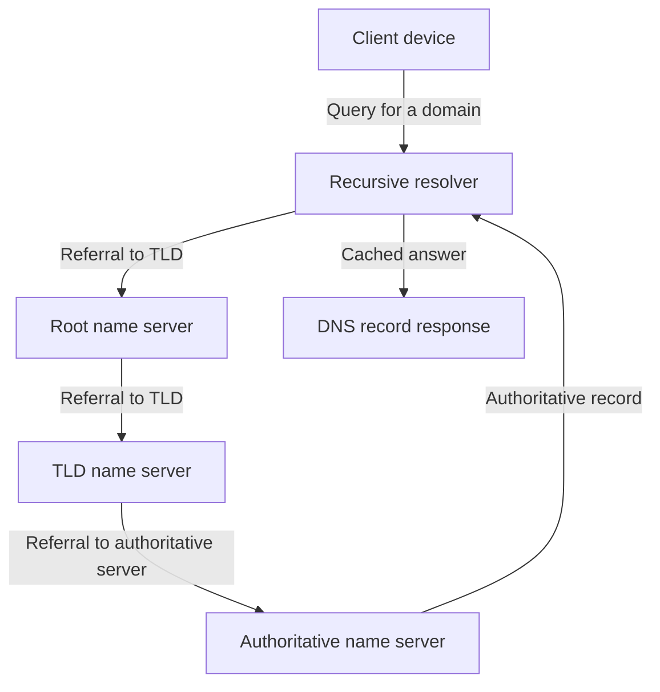

---
aliases:
  - DNS
date_created: 2026-11-03
date_modified: 2026-11-03
cf_last_run: "2026-11-03T18:55:19.771Z"
cf_last_run_model: "Perplexity sonar-pro"
for_clients:
  - LFG
tags: [Cloud-Infrastructure]
site_uuid: 2c0e1db2-7992-4700-9d29-dee01e523268
publish: true
title: "Domain Name Services"
slug: domain-name-services
at_semantic_version: 0.0.0.1
---

# Defining and Describing Domain Name Services

- _Domain Name Services turn human-readable domain names into the network information computers use to locate services._
- Domain Name Services, usually called the **Domain Name System (DNS)**, are a distributed naming system that resolves domain names into resource records such as IPv4 addresses, IPv6 addresses, mail servers, aliases, and text data. [^zj9i37] [^84mcgs]
- A typical lookup begins when a device asks a recursive resolver; if the answer is not cached, the resolver follows referrals from the root zone to a top-level-domain server and then to the domain’s authoritative name server. [^wx25bt] [^zj9i37] [^84mcgs]
- Recursive resolvers perform lookup work and cache responses, while authoritative name servers publish the source-of-truth records for zones they operate. [^wx25bt] [^51n0sz]
- DNS therefore functions both as an Internet directory and as a flexible control plane for web hosting, email delivery, service discovery, verification, and traffic management. [^iccoj5] [^xbf1zl]

## Uses in Context

- **Web navigation:** DNS resolves a site name to an address so a browser can connect to the corresponding server. [^zj9i37] [^84mcgs]
- **Email routing:** Mail-exchange records identify the servers responsible for receiving mail for a domain. [^xbf1zl]
- **Service configuration:** DNS records can publish aliases, IPv4 and IPv6 addresses, text values, and name-server delegations. [^iccoj5] [^xbf1zl]
- **Caching and performance:** Recursive resolvers retain answers for a record’s time-to-live, reducing repeated lookups and lookup latency. [^51n0sz] [^zj9i37]
- **Operational control:** Organizations use authoritative DNS zones to direct domains toward hosting platforms, mail systems, and other Internet services. [^wx25bt] [^iccoj5]
- **Security and verification:** Text records are commonly used to publish domain-verification and policy data, while DNS security extensions can provide authenticated DNS data. [^iccoj5]

## History of Use

### Origins

- The domain-name concept emerged from proposals to arrange Internet names as a hierarchy of domains; RFC 819, published in 1982 by Zaw-Sing Su and Jon Postel, proposed the tree structure. [^16f7yk]
- Computer scientist **Paul Mockapetris** developed the working DNS system at the USC Information Sciences Institute and published its early specification in RFC 882 and RFC 883 in 1983. [^16f7yk]
- RFC 1034 and RFC 1035, published in 1987, replaced those early specifications and became the core standards for DNS concepts, implementation, and message exchange. [^16f7yk]

### Evolution

- **1982–1983 — Hierarchical naming:** DNS replaced the practical limits of maintaining a single, centrally distributed host table with a delegated tree of domains. [^16f7yk]
- **1987 — Standardization:** RFC 1034 and RFC 1035 formalized DNS architecture and implementation details, including recursive and authoritative behavior. [^51n0sz] [^16f7yk]
- **Modern Internet — Distributed service layer:** DNS expanded beyond simple host lookup into a general record system supporting web addresses, mail routing, aliases, verification, and cached distributed resolution. [^iccoj5] [^xbf1zl] [^zj9i37]

## Best Real-World Examples

- [BIND](https://www.isc.org/bind/) — open-source DNS software implementing authoritative service and recursive resolution. [^16f7yk]
- [PowerDNS](https://www.powerdns.com/) — DNS server software used for authoritative hosting and recursive resolution. [^wx25bt] [^51n0sz]
- [DNSimple](https://dnsimple.com/) — hosted DNS provider whose authoritative servers publish zone records while recursive resolvers retrieve and cache answers. [^wx25bt]
- [Cloudflare DNS](https://www.cloudflare.com/dns/) — a large-scale hosted DNS service and public recursive-resolver operator that popularized managed DNS and resolver access. [^yua00r]
- [NS1](https://ns1.com/) — managed authoritative DNS service associated with traffic direction and programmable record management. [^wx25bt] [^iccoj5]
- [Public DNS resolvers](https://developers.google.com/speed/public-dns) — resolver services that accept client queries and perform recursive lookups on the user’s behalf. [^wx25bt] [^yua00r]
- [Root server system](https://www.root-servers.org/) — the uppermost referral layer that directs resolvers toward the appropriate top-level-domain servers. [^zj9i37] [^84mcgs]

## Case Studies

**Paul Mockapetris and the transition from HOSTS.TXT.** Before DNS, Internet hosts depended on a centrally maintained host-name table; the growth of connected networks made that arrangement difficult to scale. [^16f7yk] In 1982, hierarchical naming was proposed, and Paul Mockapetris turned the idea into a working distributed system at the USC Information Sciences Institute. [^16f7yk] His 1983 RFCs established the initial DNS design, while the 1987 RFC 1034 and RFC 1035 documents consolidated the architecture and implementation model. [^16f7yk] The case shows that DNS originated as a standards-driven response to coordination and scale problems, rather than as a proprietary product from a large technology incumbent.

**Recursive and authoritative separation.** DNS resolution separates two responsibilities: recursive resolvers discover answers for clients, whereas authoritative servers publish definitive records for delegated zones. [^wx25bt] [^51n0sz] During a cache miss, a resolver follows the hierarchy from the root to a top-level-domain server and then to the authoritative server for the requested domain. [^zj9i37] [^84mcgs] It caches the returned answer according to its TTL and supplies the result to the client. [^51n0sz] [^zj9i37] This division allows domain owners to control authoritative data while users and network operators obtain performance benefits from shared caching.

**DNS as a general Internet control plane.** Modern DNS is not limited to mapping a name to an IPv4 address. Authoritative zones can contain A and AAAA records for address mapping, MX records for email routing, CNAME records for aliases, TXT records for text and verification data, and NS records for delegation. [^iccoj5] [^xbf1zl] Managed DNS providers apply this record system to hosting, email, service configuration, and traffic-management workflows, while recursive services make the resulting data broadly accessible through cached resolution. [^wx25bt] [^iccoj5] [^zj9i37] The case demonstrates how an open technical standard became foundational infrastructure whose innovation has continued through standards work, open-source implementations, and specialized service providers.

***

# Sources

[^wx25bt]: 2026, May 13. [support.dnsimple.com](https://support.dnsimple.com/). [Recursive vs Authoritative DNS Resolvers - DNSimple Help](https://support.dnsimple.com/articles/recursive-vs-authoritative-dns-resolvers/). Updated: 2026, Oct 27. Generated: 2026, Nov 03. [Perplexity](https://www.perplexity.ai/) API response.
[^51n0sz]: 2026, Aug 22. [scoutdns.com](https://www.scoutdns.com/). [Recursive vs Authoritative DNS: Who Answers What, and ...](https://www.scoutdns.com/library/recursive-vs-authoritative-dns/). Updated: 2026, Oct 03. Generated: 2026, Nov 03. [Perplexity](https://www.perplexity.ai/) API response.
[3]: 2026, Sep 15. [dope.security](https://dope.security/). [Recursive vs Authoritative DNS (and Why It Matters for ...](https://dope.security/post/recursive-vs-authoritative-dns). Updated: 2026, Nov 01. Generated: 2026, Nov 03. [Perplexity](https://www.perplexity.ai/) API response.
[^iccoj5]: 2025, Nov 21. [transip.eu](https://www.transip.eu/). [Why use/not use your own DNS resolver - TransIP](https://www.transip.eu/knowledgebase/why-usenot-use-your-own-dns-resolver). Updated: 2026, Nov 03. Generated: 2026, Nov 03. [Perplexity](https://www.perplexity.ai/) API response.
[^xbf1zl]: 2026, Aug 21. [manageengine.com](https://www.manageengine.com/). [How DNS works: DNS architecture, resolution, and propagation …](https://www.manageengine.com/products/oputils/tech-topics/how-dns-works.html). Updated: 2026, Oct 07. Generated: 2026, Nov 03. [Perplexity](https://www.perplexity.ai/) API response.
[6]: 2026, Oct 26. [bluecatnetworks.com](https://bluecatnetworks.com/). [What is an authoritative DNS server? | BlueCat](https://bluecatnetworks.com/glossary/authoritative-dns-server/). Updated: 2026, Oct 28. Generated: 2026, Nov 03. [Perplexity](https://www.perplexity.ai/) API response.
[^zj9i37]: 2026, Jul 24. [tencentcloud.com](https://www.tencentcloud.com/). [What Is DNS How Domain Name Resolution Works - Tencent Cloud](https://www.tencentcloud.com/techpedia/144704). Updated: 2026, Oct 19. Generated: 2026, Nov 03. [Perplexity](https://www.perplexity.ai/) API response.
[^16f7yk]: 2026, Oct 15. [ssdnodes.com](https://www.ssdnodes.com/). [The History of DNS, From HOSTS.TXT to DoH · SSD Nodes](https://www.ssdnodes.com/learn/history-of-dns). Updated: 2026, Nov 02. Generated: 2026, Nov 03. [Perplexity](https://www.perplexity.ai/) API response.
[^yua00r]: 2026, Aug 03. [dev.to](https://dev.to/). [How DNS Works](https://dev.to/theserverguy/how-dns-works-25j6). Updated: 2026, Oct 09. Generated: 2026, Nov 03. [Perplexity](https://www.perplexity.ai/) API response.
[^84mcgs]: 2026, Jun 19. [who.is](https://who.is/). [What Is DNS? How the Domain Name System Works](https://who.is/learn/what-is-dns). Updated: 2026, Oct 02. Generated: 2026, Nov 03. [Perplexity](https://www.perplexity.ai/) API response.
